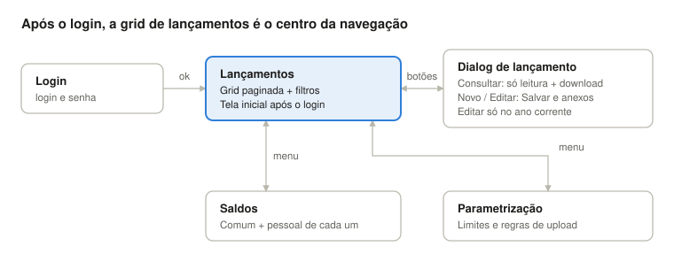
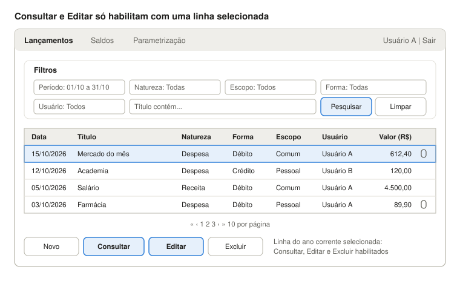
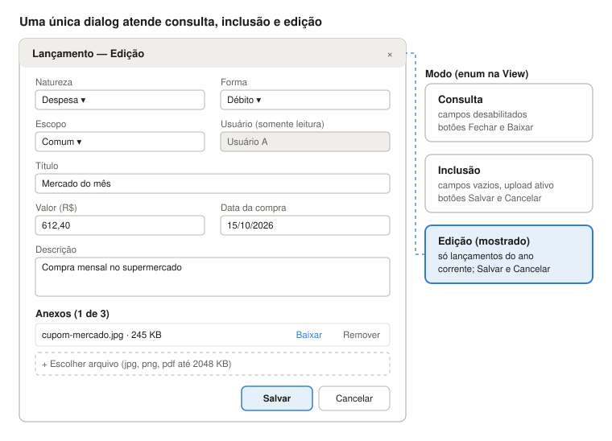
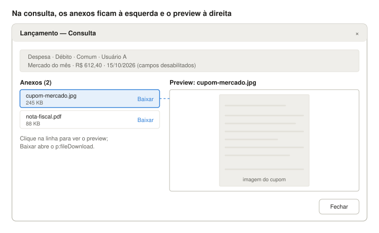
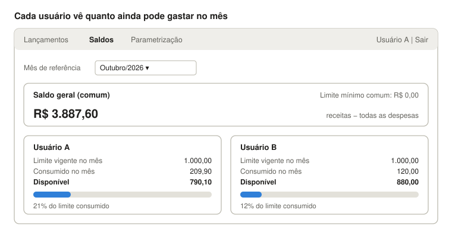
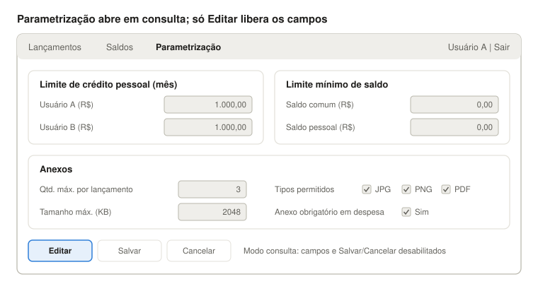

# Telas, comportamento e regras de negócio

Como cada tela se parece, como se comporta e quais regras o sistema aplica.

## 1. Exemplos de tela

Os wireframes mostram o resultado esperado de cada tela; os valores são ilustrativos. O comportamento de cada uma está na seção 2.

### Navegação entre telas



A dialog é aberta pelos botões abaixo da grid; Saldos e Parametrização são alcançadas pelo menu.

### Tela de lançamentos



Valores ilustrativos; o clipe na última coluna indica lançamento com anexo.

### Dialog de lançamento



Os limites de upload exibidos (tipos, tamanho, quantidade) vêm da parametrização, não ficam fixos no XHTML.

### Dialog em consulta com anexos



A linha selecionada na lista define o preview; PDF abre no `p:media` e tipos sem preview mostram `msg_001_019_avs`.

### Tela de saldos



Valores ilustrativos; o disponível volta ao limite cheio no primeiro dia de cada mês.

### Tela de parametrização



Ao clicar em Editar, os campos e os botões Salvar/Cancelar habilitam e o Editar desabilita.

## 2. Funcionalidades

O sistema tem quatro telas: Login, Lançamentos (tela inicial após login), Saldos e Parametrização, além da dialog de lançamento usada para consultar, incluir e editar. Um menu superior (`p:menubar`) liga as três telas internas e mostra o usuário logado com a opção Sair.

### 2.1 Login e logout

- Campos: login e senha. Botão Entrar.
- Senha gravada com hash (`java.security.MessageDigest` do próprio java8 para SHA-512); nunca em texto puro.
- Sucesso: guarda o `UsuarioModel` em um bean `@SessionScoped` (`UsuarioLogadoView`) e redireciona para `lancamentos.xhtml`.
- Um `WebFilter` bloqueia páginas internas sem sessão e redireciona para o login.

Sair (logout): invalida a sessão (`session.invalidate()`) e redireciona para o login.

Mensagens: `msg_004_001_err` (login ou senha inválidos), `msg_000_002_avs` (sessão expirada, ao cair no login pelo filtro), `msg_004_002_suc` (Sair).

### 2.2 Lançamentos (grid)

- **Filtros** (`p:panelGrid` acima da grid): período (data de / até, padrão = mês corrente), natureza (Receita/Despesa/Todas), escopo (Comum/Pessoal/Todos), forma (Débito/Crédito/Todas), usuário (Todos/Usuário A/Usuário B) e título (contém). Botões Pesquisar e Limpar.
- **Grid** (`p:dataTable` com `LazyDataModel`, `selectionMode="single"`, 10 linhas por página, ordenação por coluna): Data, Título, Natureza, Forma, Escopo, Usuário, Valor (R$, alinhado à direita) e um ícone de clipe quando houver anexo.
- A paginação é feita no banco: o DAO executa SQL nativo.
- **Botões abaixo da grid**:

| Botão | Habilitado quando | Ação |
| --- | --- | --- |
| Novo | Sempre | Abre a dialog em modo inclusão |
| Consultar | Há registro selecionado | Abre a dialog em modo consulta (somente leitura) |
| Editar | Há registro selecionado **e** ele é editável (ano corrente + permissão) | Abre a dialog em modo edição |
| Excluir | Mesma regra do Editar | Pede confirmação (`p:confirmDialog`) e exclui |

O estado dos botões é controlado pela View: o evento `rowSelect`/`rowUnselect` da grid atualiza a seleção e os botões usam `disabled="#{!lancamentoView.podeEditar}"`, com `update` apontando para o painel de botões.

Mensagens: `msg_001_005_avs` (pesquisa sem resultado), `msg_001_004_avs` (confirmação do Excluir), `msg_001_003_suc` (excluído); se o Business recusar a exclusão, `msg_001_007_err` ou `msg_001_008_err`; se o outro usuário já excluiu o lançamento, `msg_001_021_err`. Excluir fica desabilitado durante a requisição (RN22).

### 2.3 Dialog de lançamento (consulta / inclusão / edição)

- Uma única `p:dialog` com um enum de modo na View (`CONSULTA`, `INCLUSAO`, `EDICAO`). Em consulta, todos os campos ficam `disabled` e só o botão Fechar aparece; em inclusão/edição aparecem Salvar e Cancelar.
- Campos: Natureza (Receita/Despesa), Forma (Débito/Crédito), Escopo (Comum/Pessoal), Usuário (preenchido com o logado, somente leitura), Título, Valor, Data, Data de vencimento da fatura (só aparece quando Forma = Crédito, via AJAX) e Descrição.
- **Anexos**: em consulta, a área fica em **duas colunas**: à esquerda a lista dos arquivos, à direita o preview do anexo selecionado na lista (imagem via `p:graphicImage` + `StreamedContent`; PDF via `p:media`; outros tipos mostram `msg_001_019_avs`). Botão de download (`p:fileDownload`) em todos os modos; em inclusão/edição, `p:fileUpload` (modo avançado) com `sizeLimit`, `fileLimit` e `allowTypes` vindos da parametrização, e botão de remover anexo.
- Erros de validação e de negócio (`BusinessException`) aparecem em `p:messages` dentro da dialog, e a dialog só fecha em caso de sucesso (`args.validationFailed` / callback param).

Mensagens: `msg_001_001_suc` (incluído), `msg_001_002_suc` (editado), `msg_000_003_err` (campo obrigatório), as das regras RN02, RN05, RN06, RN08, RN11, RN14, RN16, RN19, RN20 e RN21 (coluna Mensagem da seção 3), `msg_001_018_suc` (arquivo anexado), `msg_001_014_err` a `msg_001_016_err` (upload recusado), `msg_001_019_avs` (preview indisponível), `msg_001_021_err` (lançamento excluído por outro usuário), `msg_001_022_err` (anexo removido), `msg_001_023_err` (limites alterados durante a gravação). Salvar e anexar ficam desabilitados durante a requisição (RN22).

### 2.4 Saldos

- Seletor de mês/ano (padrão = mês corrente).
- **Saldo geral (comum)**: total de receitas − total de despesas (comuns e pessoais), acumulado até o fim do mês selecionado, exibido junto do limite mínimo comum.
- **Saldo pessoal de cada usuário**: limite de crédito pessoal vigente no mês, valor consumido no mês e saldo disponível (limite − despesas pessoais do mês), com uma barra de progresso (`p:progressBar`).
- Os valores vêm de um `SaldoHelper` calculado no `SaldoBusiness` com SQL nativo agregado (Dica: `SUM ... GROUP BY`).

Mensagens: `msg_002_001_avs` (nenhum lançamento no mês selecionado).

### 2.5 Parametrização

- Abre em modo consulta; o botão Editar habilita os campos; Salvar e Cancelar encerram a edição.
- Campos: limite de crédito pessoal de cada usuário (**padrão** R$ 1.000,00; a alteração vale do mês corrente em diante), limite mínimo do saldo comum, limite mínimo do saldo pessoal, quantidade máxima de anexos por lançamento, tamanho máximo por arquivo (KB), tipos permitidos (JPG, PNG, PDF) e se o anexo é obrigatório em despesas.
- Gravação protegida com `@Version` (bloqueio otimista): se o outro usuário salvou antes, exibe mensagem pedindo para recarregar.

Mensagens: `msg_003_001_suc` (salvo), `msg_003_002_err` (alterado por outro usuário), `msg_003_003_err` a `msg_003_006_err` (validações dos campos).

## 3. Regras de negócio

Todas as regras abaixo são validadas no Business (camada servidor), mesmo que a tela também as aplique. Cada regra tem um código para ser citado em testes, mensagens e revisões.

| Código | Regra | Mensagem |
| --- | --- | --- |
| RN01 | Cada lançamento tem natureza (Receita ou Despesa), forma (Débito ou Crédito), escopo (Comum ou Pessoal), usuário, título, valor, data e descrição. Título, valor, data, natureza, forma e escopo são obrigatórios. | `msg_000_003_err` |
| RN02 | O valor é sempre positivo. O sinal no saldo vem da natureza: receita soma, despesa subtrai. | `msg_001_006_err` |
| RN03 | O usuário do lançamento é sempre o usuário logado no momento da inclusão; não pode ser alterado na edição. | — |
| RN04 | Os dois usuários consultam todos os lançamentos (comuns e pessoais). | — |
| RN05 | Edição e exclusão só são permitidas se a data do lançamento estiver no **ano corrente** (ano do servidor). Na edição, a nova data também deve estar no ano corrente. | `msg_001_007_err`, `msg_001_020_err` |
| RN06 | Lançamento **comum** pode ser editado/excluído pelos dois usuários; lançamento **pessoal** só pelo próprio dono. | `msg_001_008_err` |
| RN07 | **Saldo comum** = Σ todas as receitas − Σ todas as despesas, comuns e pessoais (acumulado). Todo dinheiro sai do comum: despesa pessoal também é um saque do comum. | — |
| RN08 | Toda despesa (comum ou pessoal) só é aceita se `saldo comum − valor ≥ limite mínimo comum`. | `msg_001_009_err` |
| RN09 | Cada usuário tem um **limite de crédito pessoal mensal** (padrão R$ 1.000,00, definido na parametrização). O saldo renova todo mês. Alterar o limite vale do mês corrente em diante; meses anteriores mantêm o limite que estava vigente (histórico em TB_LIMITE_USUARIO). | — |
| RN10 | **Saldo pessoal disponível do mês** = limite pessoal − Σ despesas pessoais do usuário naquele mês (pelo mês da data de efetivação, RN14). | — |
| RN11 | Além da RN08, uma despesa pessoal só é aceita se `saldo pessoal disponível − valor ≥ limite mínimo pessoal`. | `msg_001_010_err` |
| RN12 | Na edição de uma despesa, o valor antigo é devolvido ao saldo antes de validar o novo valor (e o mês antigo é liberado se a data mudar de mês). | — |
| RN13 | Receita pessoal entra no saldo comum (RN07), mas **não aumenta** o limite de crédito pessoal: o saldo pessoal depende só do limite da parametrização, que é custeado pela receita comum. | — |
| RN14 | Despesa no débito sai do saldo na data da compra; despesa no crédito sai na data de vencimento da fatura (quando o dinheiro sai). Essa é a data de efetivação (DT_EFETIVACAO), que define o mês nos saldos comum e pessoal. A data do lançamento continua valendo para a grid, os filtros e a RN05. | `msg_001_011_err` |
| RN15 | Anexos: tipos, tamanho máximo por arquivo e quantidade máxima por lançamento seguem a parametrização; validados no `p:fileUpload` **e** no `AnexoBusiness`. | `msg_001_014_err`, `msg_001_015_err`, `msg_001_016_err` |
| RN16 | Se a parametrização marcar "anexo obrigatório em despesa", uma despesa sem anexo não é salva. | `msg_001_017_err` |
| RN17 | Qualquer usuário pode baixar anexos de qualquer lançamento que consegue consultar. | — |
| RN18 | Excluir um lançamento exclui seus anexos na mesma transação. | — |
| RN19 | Dois usuários lançando despesas ao mesmo tempo nunca podem, juntos, deixar o saldo comum abaixo do limite mínimo; o conflito é detectado por bloqueio otimista; a operação é recusada e a tela é atualizada ([Especificação técnica](03-especificacao-tecnica.md#2-concorrência), Concorrência). | `msg_001_013_err` (conflito de versão no saldo) |
| RN20 | Se o registro foi alterado ou excluído por outro usuário depois de aberto na dialog, a gravação é recusada com mensagem para recarregar (bloqueio otimista; [Especificação técnica](03-especificacao-tecnica.md#2-concorrência)). | `msg_001_012_err` (lançamento), `msg_003_002_err` (parâmetros), `msg_001_021_err` (excluído), `msg_001_022_err` (anexo removido) |
| RN21 | Despesas são validadas com o limite pessoal e o limite mínimo vigentes no momento da gravação; se outro usuário os alterar durante a operação, ela é recusada e a tela é atualizada. | `msg_001_023_err` |
| RN22 | Salvar, Excluir e anexar ficam desabilitados enquanto a requisição está em andamento, para que um duplo clique não grave duas vezes. | — |

### Exemplo de saldo pessoal

Usuário A, limite R$ 1.000,00, limite mínimo pessoal R$ 0,00, outubro/2026:

| Data | Lançamento | Valor | Disponível após |
| --- | --- | --- | --- |
| 03/10 | Despesa pessoal — Academia | R$ 120,00 | R$ 880,00 |
| 10/10 | Despesa pessoal — Roupa | R$ 450,00 | R$ 430,00 |
| 18/10 | Despesa pessoal — Presente | R$ 500,00 | Recusada (ficaria −R$ 70,00) |
| 01/11 | Novo mês | — | R$ 1.000,00 |

## 4. Mensagens

Toda mensagem exibida ao usuário (sucesso, aviso ou erro) fica em `frontend.properties`, no formato chave = valor. O código nunca escreve o texto: lança a chave, e a View resolve o texto. As seções 2 e 3 indicam a chave usada em cada ponto.

### Padrão da chave

`msg_<tela>_<sequencial>_<tipo>`

| Parte | Valores |
| --- | --- |
| tela | `000` geral · `001` lançamentos (grid e dialog) · `002` saldos · `003` parametrização · `004` login |
| sequencial | `001` a `999` dentro da tela; um número nunca é reaproveitado |
| tipo | `suc` sucesso (`SEVERITY_INFO`) · `avs` aviso (`SEVERITY_WARN`) · `err` erro (`SEVERITY_ERROR`) |

Parâmetros no texto usam `{0}`, `{1}` e são preenchidos com `MessageFormat`.

### Como usar (Dicas)

- Arquivo `src/main/resources/frontend.properties`. No Java 8 o `ResourceBundle` lê `.properties` como ISO-8859-1: usar escapes (`\u00e7`) ou um `ResourceBundle.Control` que leia UTF-8.
- Registrado no `faces-config.xml` como `<resource-bundle>` com `var="msg"`, para uso no XHTML: `requiredMessage="#{msg['msg_000_003_err']}"`.
- `BusinessException` carrega a chave e os parâmetros; a View converte em `FacesMessage` por um `MensagemUtil.adicionar(chave, params...)`, que define a severidade pelo sufixo da chave.

```properties
msg_001_002_suc=Lançamento editado com sucesso.
msg_001_009_err=Saldo comum insuficiente: disponível R$ {0}, limite mínimo R$ {1}.
```

```java
throw new BusinessException("msg_001_009_err", saldoComum, limiteMinimo);
```

### Tabela de mensagens

| Chave | Tipo | Texto | Onde é lançada |
| --- | --- | --- | --- |
| `msg_000_001_err` | Erro | Erro inesperado. Tente novamente ou contate o suporte. | Qualquer exceção não tratada |
| `msg_000_002_avs` | Aviso | Sessão expirada. Faça login novamente. | Filtro de autenticação (2.1) |
| `msg_000_003_err` | Erro | O campo {0} é obrigatório. | Obrigatórios da dialog (2.3, RN01) |
| `msg_001_001_suc` | Sucesso | Lançamento incluído com sucesso. | Salvar na inclusão (2.3) |
| `msg_001_002_suc` | Sucesso | Lançamento editado com sucesso. | Salvar na edição (2.3) |
| `msg_001_003_suc` | Sucesso | Lançamento excluído com sucesso. | Excluir (2.2) |
| `msg_001_004_avs` | Aviso | Confirma a exclusão do lançamento "{0}"? | Confirmação do Excluir (2.2) |
| `msg_001_005_avs` | Aviso | Nenhum lançamento encontrado para o filtro informado. | Pesquisar (2.2) |
| `msg_001_006_err` | Erro | O valor deve ser maior que zero. | RN02 |
| `msg_001_007_err` | Erro | Só é possível editar ou excluir lançamentos do ano corrente. | RN05 |
| `msg_001_008_err` | Erro | Lançamento pessoal só pode ser alterado pelo próprio dono. | RN06 |
| `msg_001_009_err` | Erro | Saldo comum insuficiente: disponível R$ {0}, limite mínimo R$ {1}. | RN08 |
| `msg_001_010_err` | Erro | Saldo pessoal insuficiente em {0}: disponível R$ {1}. | RN11 |
| `msg_001_011_err` | Erro | Informe a data de vencimento da fatura para lançamentos no crédito. | RN14 |
| `msg_001_012_err` | Erro | Registro alterado por outro usuário. Recarregue e tente novamente. | RN20 |
| `msg_001_013_err` | Erro | O saldo foi alterado por outro lançamento. A tela foi atualizada; confira e tente novamente. | RN19 (conflito de versão no saldo) |
| `msg_001_014_err` | Erro | Tipo de arquivo não permitido. Tipos aceitos: {0}. | RN15 |
| `msg_001_015_err` | Erro | O arquivo excede o tamanho máximo de {0} KB. | RN15 |
| `msg_001_016_err` | Erro | Limite de {0} anexos por lançamento atingido. | RN15 |
| `msg_001_017_err` | Erro | Despesa exige ao menos um anexo. | RN16 |
| `msg_001_018_suc` | Sucesso | Arquivo {0} anexado. | Upload (2.3) |
| `msg_001_019_avs` | Aviso | Preview indisponível para este tipo de arquivo. Use Baixar. | Preview na consulta (2.3) |
| `msg_001_020_err` | Erro | A data do lançamento deve estar no ano corrente. | RN05 (nova data na edição) |
| `msg_001_021_err` | Erro | Este lançamento foi excluído por outro usuário. A tela foi atualizada. | Editar ou excluir (2.2, 2.3), RN20 |
| `msg_001_022_err` | Erro | Anexo não encontrado; ele pode ter sido removido por outro usuário. A tela foi atualizada. | Baixar ou ver preview (2.3), RN20 |
| `msg_001_023_err` | Erro | Os limites foram alterados por outro usuário durante o lançamento. A tela foi atualizada; confira e tente novamente. | Salvar na dialog (2.3), RN21 |
| `msg_002_001_avs` | Aviso | Nenhum lançamento no mês selecionado. | Trocar mês (2.4) |
| `msg_003_001_suc` | Sucesso | Parâmetros salvos com sucesso. | Salvar (2.5) |
| `msg_003_002_err` | Erro | Parâmetros alterados por outro usuário. Recarregue e tente novamente. | Salvar (2.5), RN20 |
| `msg_003_003_err` | Erro | O limite pessoal não pode ser negativo. | Salvar (2.5) |
| `msg_003_004_err` | Erro | O tamanho máximo deve ser maior que zero. | Salvar (2.5) |
| `msg_003_005_err` | Erro | A quantidade máxima de anexos deve ser ao menos 1. | Salvar (2.5) |
| `msg_003_006_err` | Erro | Selecione ao menos um tipo de arquivo. | Salvar (2.5) |
| `msg_004_001_err` | Erro | Login ou senha inválidos. | Entrar (2.1) |
| `msg_004_002_suc` | Sucesso | Sessão encerrada. | Sair (2.1) |

## 5. Decisões registradas

- Receita pessoal não aumenta o saldo pessoal; o saldo pessoal vem do limite, custeado pela receita comum (RN13).
- Despesa no crédito entra nos saldos pela data de vencimento da fatura, quando o dinheiro sai (RN14, coluna `DT_EFETIVACAO`).
- Mudança do limite pessoal vale do mês corrente em diante; meses passados mantêm o limite da época (RN09, histórico em `TB_LIMITE_USUARIO`).
