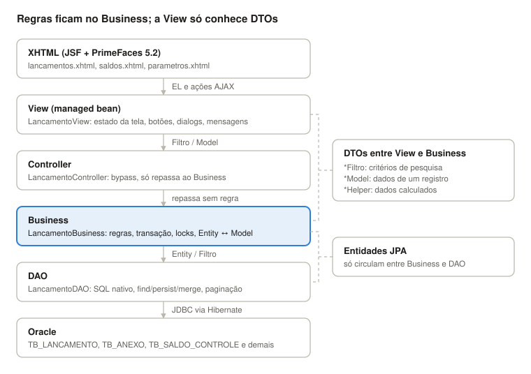
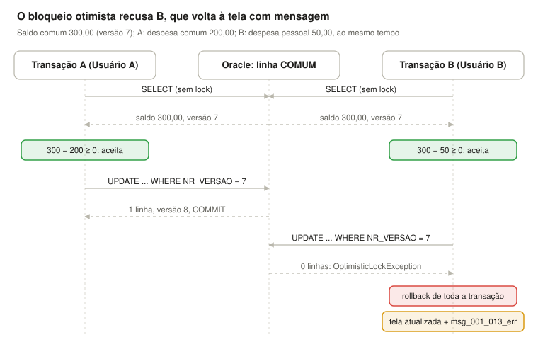
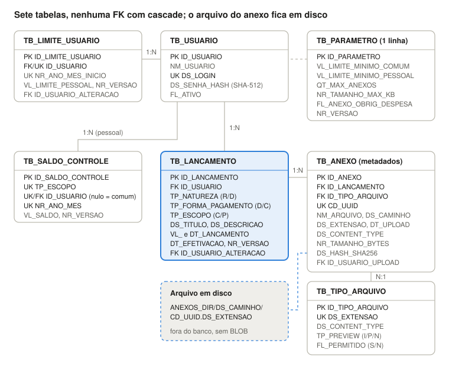

# Especificação técnica

Arquitetura, concorrência, modelo de dados e dicionário de dados (Oracle).

## 1. Arquitetura

Toda requisição desce por quatro camadas, e cada uma tem uma única responsabilidade. A View nunca acessa DAO diretamente, e regra de negócio nunca fica na View. As regras citadas como RNxx estão em Telas e regras de negócio.



Disca: A chamada desce da tela ao banco; o retorno sobe como Model ou Helper, e entidades JPA nunca chegam à View.

| Camada | Classe (exemplo) | Responsabilidade | Não deve |
| --- | --- | --- | --- |
| XHTML | `lancamentos.xhtml` | Componentes PrimeFaces, bindings `#{lancamentoView...}` | Conter lógica além de `rendered`/`disabled` simples |
| View (managed bean) | `LancamentoView` (`@Named @ViewScoped`) | Estado da tela, habilitar/desabilitar botões, abrir dialogs, mensagens `FacesMessage`, chamar o Controller | Acessar `EntityManager` ou validar regra de negócio |
| Controller | `LancamentoController` | Bypass: repassa chamadas da View para o Business (mantém o padrão do sistema principal) | Ter regras |
| Business | `LancamentoBusiness` | Regras de negócio, validações, controle de transação e concorrência, conversão Entity ↔ Model | Montar componentes de tela |
| DAO | `LancamentoDAO` | Acesso ao Oracle via Hibernate: SQL nativo, `find`, `persist`, `merge` | Decidir regra de negócio |

### Convenção de DTOs

| Sufixo | Uso | Exemplos |
| --- | --- | --- |
| `*Filtro` | Critérios de pesquisa enviados da tela até o DAO (inclui paginação e ordenação) | `LancamentoFiltro` (usuário, natureza, escopo, forma, período, título, `first`, `pageSize`, `sortField`) |
| `*Model` ou  `*Helper` | Dados de um registro trafegando entre camadas e exibidos na tela/dialog e/ou dados calculados ou agregados para exibição, sem entidade correspondente | `LancamentoModel`, `AnexoModel`, `ParametroModel`, `UsuarioModel,  SaldoHelper ` (saldo comum, saldo pessoal por usuário), `ResultadoPaginadoHelper<T>` (lista + total de registros) |

Entidades JPA (Lancamento, Anexo, TipoArquivo, Usuario, Parametro, ParametroAnexo, LimiteUsuario, SaldoControle) ficam restritas ao Business e ao DAO; a View só conhece Models, Filtros e Helpers.

### Estrutura de pacotes sugerida

```
br.com.empresa.orcamento
 ├── view          (LancamentoView, SaldoView, ParametroView, LoginView, UsuarioLogadoView)
 ├── controller    (LancamentoController, SaldoController, ParametroController, LoginController)
 ├── business      (LancamentoBusiness, SaldoBusiness, ParametroBusiness, AnexoBusiness, LoginBusiness)
 ├── dao           (LancamentoDAO, AnexoDAO, TipoArquivoDAO, ParametroDAO, ParametroAnexoDAO, LimiteUsuarioDAO, UsuarioDAO, SaldoControleDAO)
 ├── entity        (Lancamento, Anexo, TipoArquivo, Usuario, Parametro, ParametroAnexo, LimiteUsuario, SaldoControle)
 ├── storage       (ArmazenamentoAnexo, ArquivoAnexoObserver)
 ├── dto
 │    ├── filtro   (LancamentoFiltro)
 │    ├── model    (LancamentoModel, AnexoModel, TipoArquivoModel, ParametroModel, UsuarioModel)
 │    └── helper   (SaldoHelper, ResultadoPaginadoHelper)
 ├── enums         (Natureza, FormaPagamento, Escopo, TipoPreview)
 ├── filter        (AutenticacaoFilter)
 └── exception     (BusinessException, ConcorrenciaException)
```

## 2. Concorrência

Todo dinheiro sai do saldo comum, então toda receita e toda despesa (comum ou pessoal) alteram a linha comum de `TB_SALDO_CONTROLE`. Essa linha é protegida por **bloqueio otimista** do Hibernate: a coluna `NR_VERSAO` (`@Version`) muda a cada gravação, e quem tenta gravar com uma versão desatualizada é recusado. **Não há retentativa automática**: a operação inteira é desfeita, a tela mostra `msg_001_013_err` e é atualizada com os dados atuais, e o usuário decide se tenta de novo.

O mesmo vale para dois usuários editando o mesmo registro: `TB_LANCAMENTO`, `TB_PARAMETRO`, `TB_PARAMETRO_ANEXO` e `TB_LIMITE_USUARIO` também têm `NR_VERSAO`, e quem salva por último recebe `msg_001_012_err` (lançamento) ou `msg_003_002_err` (parâmetros). A exclusão lógica (`FL_ATIVO = 'N'`) é um UPDATE como outro qualquer, então também passa pela versão.



A e B leem a mesma versão; só o primeiro `UPDATE` encontra a linha na versão 7. O de B afeta 0 linhas, a transação de B é desfeita e a tela de B é atualizada com a mensagem.

### Pontos com tratamento de concorrência

Em todos os casos a operação é desfeita por inteiro, a mensagem é exibida e a tela (grid, dialog e saldos) é recarregada com os dados atuais.

| Ponto | Tratamento | Mensagem |
| --- | --- | --- |
| Incluir, editar ou excluir qualquer lançamento (altera o saldo comum) | `@Version` na linha comum de `TB_SALDO_CONTROLE` | `msg_001_013_err` |
| Incluir, editar ou excluir despesa pessoal | `@Version` na linha comum e na linha pessoal do mês; conflito em qualquer uma desfaz tudo | `msg_001_013_err` |
| Editar trocando mês de efetivação, escopo ou forma | Atualiza a linha pessoal do mês antigo e a do novo, além da comum, todas versionadas | `msg_001_013_err` |
| Primeira despesa pessoal do mês (criação da linha) | UK `(TP_ESCOPO, ID_USUARIO, NR_ANO_MES)`; a violação (ORA-00001) desfaz a operação | `msg_001_013_err` |
| Dois usuários editando o mesmo lançamento | `@Version` em `TB_LANCAMENTO` | `msg_001_012_err` |
| Editar ou excluir lançamento que o outro usuário excluiu (inclui excluir duas vezes) | O Business busca o registro ativo (`FL_ATIVO = 'S'`) pelo id antes de alterar; se está inativo, recusa | `msg_001_021_err` |
| Anexar ou remover arquivo enquanto o outro edita o lançamento | Toda alteração de anexo incrementa a versão do lançamento (`LockModeType.OPTIMISTIC_FORCE_INCREMENT`) | `msg_001_012_err` |
| Dois usuários anexando ao mesmo lançamento além da quantidade máxima | O mesmo incremento de versão recusa o segundo; ao repetir, a contagem já inclui os anexos do primeiro | `msg_001_012_err`, depois `msg_001_016_err` |
| Baixar ou ver o preview de anexo já removido | O Business busca o anexo ativo pelo id; se está inativo ou o arquivo não está em disco, recusa | `msg_001_022_err` |
| Dois usuários salvando parâmetros | `@Version` em `TB_PARAMETRO`, `TB_PARAMETRO_ANEXO` e `TB_LIMITE_USUARIO`; marcar ou desmarcar tipos de arquivo força o incremento da versão de `TB_PARAMETRO_ANEXO` (`LockModeType.OPTIMISTIC_FORCE_INCREMENT`) | `msg_003_002_err` |
| Novo limite pessoal no mês corrente (criação do registro de vigência) | UK `(ID_USUARIO, NR_ANO_MES_INICIO)`; a violação desfaz a gravação | `msg_003_002_err` |
| Despesa lançada enquanto o outro altera o limite pessoal ou o limite mínimo | Parâmetro e limite lidos na mesma transação com `LockModeType.OPTIMISTIC` (versão conferida no commit) | `msg_001_023_err` |
| Regras de upload alteradas com a dialog aberta | Sem lock: o servidor revalida com as regras atuais ao gravar | `msg_001_014_err` a `msg_001_016_err` |
| Duplo clique em Salvar, Excluir ou anexar | Botão desabilitado e dialog bloqueada durante a requisição AJAX (`p:blockUI` ou `onstart`/`oncomplete`) | — |
| Mesmo usuário com duas abas abertas | Sem tratamento próprio: cai nos casos acima, como dois usuários | conforme o caso |
| Grid e tela de saldos mostrando dados antigos | Sem lock: o Business revalida toda ação; a tela é atualizada após qualquer mensagem de conflito | conforme o caso |

### Testes obrigatórios

- Duas threads (`ExecutorService` + `CountDownLatch`) lançando despesas ao mesmo tempo: exatamente uma gravada; a outra recebe o conflito de versão e nada dela fica gravado (nem o lançamento, nem os anexos, nem arquivos na pasta definitiva).
- Depois do conflito, repetir a operação recusada: grava se o saldo atual comportar, ou é recusada por `msg_001_009_err` se não comportar.
- Uma despesa comum e uma pessoal simultâneas: o conflito aparece na linha comum.
- Duas primeiras despesas pessoais do mesmo usuário no mesmo mês, simultâneas: uma grava e cria a linha do mês; a outra recebe `msg_001_013_err`.
- Dois usuários editando o mesmo lançamento: o segundo recebe `msg_001_012_err`.
- Excluir um lançamento enquanto o outro o edita: quem chegar depois recebe `msg_001_021_err` ou `msg_001_012_err`.
- Dois usuários anexando ao mesmo lançamento ao mesmo tempo: o segundo recebe `msg_001_012_err`.
- Despesa pessoal lançada enquanto o limite pessoal é alterado: a despesa recebe `msg_001_023_err`.
- Logar cada conflito para o estagiário ver o bloqueio acontecendo.

## 3. Modelo de dados

São oito tabelas: o lançamento é o centro, com os anexos (só metadados; o arquivo fica em disco) e as extensões aceitas, os limites históricos por usuário, as linhas de saldo versionadas e a parametrização em duas tabelas (limites de saldo e regras de anexo). Nada é apagado: as exclusões são lógicas (`FL_ATIVO = 'N'`) e nenhuma FK usa cascade.



A linha tracejada cinza é FK só de auditoria (quem alterou); as demais FKs de auditoria estão no quadro abaixo. A linha tracejada azul liga o metadado ao arquivo em disco, que não é uma tabela.

### Chaves estrangeiras (sem cascade)

| FK | Coluna | Referencia | Índice da coluna |
| --- | --- | --- | --- |
| FK_LANCAMENTO_USUARIO | TB_LANCAMENTO.ID_USUARIO | TB_USUARIO | IX_LANCAMENTO_USU_ESC_EFET (1ª coluna) |
| FK_LANCAMENTO_USUARIO_ALT | TB_LANCAMENTO.ID_USUARIO_ALTERACAO | TB_USUARIO | IX_LANCAMENTO_USUARIO_ALT |
| FK_ANEXO_LANCAMENTO | TB_ANEXO.ID_LANCAMENTO | TB_LANCAMENTO | IX_ANEXO_LANCAMENTO |
| FK_ANEXO_TIPO_ARQUIVO | TB_ANEXO.ID_TIPO_ARQUIVO | TB_TIPO_ARQUIVO | IX_ANEXO_TIPO_ARQUIVO |
| FK_ANEXO_USUARIO | TB_ANEXO.ID_USUARIO_UPLOAD | TB_USUARIO | IX_ANEXO_USUARIO |
| FK_TIPO_ARQUIVO_USUARIO_ALT | TB_TIPO_ARQUIVO.ID_USUARIO_ALTERACAO | TB_USUARIO | IX_TIPO_ARQUIVO_USUARIO_ALT |
| FK_PARAMETRO_USUARIO_ALT | TB_PARAMETRO.ID_USUARIO_ALTERACAO | TB_USUARIO | IX_PARAMETRO_USUARIO_ALT |
| FK_PARAMETRO_ANEXO_USUARIO_ALT | TB_PARAMETRO_ANEXO.ID_USUARIO_ALTERACAO | TB_USUARIO | IX_PARAMETRO_ANEXO_USUARIO_ALT |
| FK_LIMITE_USUARIO_USUARIO | TB_LIMITE_USUARIO.ID_USUARIO | TB_USUARIO | UK_LIMITE_USUARIO_VIGENCIA (1ª coluna) |
| FK_LIMITE_USUARIO_USUARIO_ALT | TB_LIMITE_USUARIO.ID_USUARIO_ALTERACAO | TB_USUARIO | IX_LIMITE_USUARIO_USUARIO_ALT |
| FK_SALDO_CONTROLE_USUARIO | TB_SALDO_CONTROLE.ID_USUARIO | TB_USUARIO | IX_SALDO_CONTROLE_USUARIO |

- A aplicação não faz DELETE: excluir é marcar `FL_ATIVO = 'N'` (lançamento, anexo, tipo de arquivo, parâmetros; usuário também tem `FL_ATIVO`). Toda consulta da grid, dos saldos e da contagem de anexos filtra `FL_ATIVO = 'S'`.
- No banco, nenhuma FK tem `ON DELETE CASCADE` ou `ON DELETE SET NULL`. Um DELETE manual de registro com filhos é recusado pelo Oracle (ORA-02292).
- No JPA, o relacionamento é mapeado só no lado dono, com `@ManyToOne(fetch = FetchType.LAZY)` e `@JoinColumn`, sem o atributo `cascade`. Não mapear `@OneToMany` (por exemplo `Lancamento.anexos`) nem usar `orphanRemoval`: os anexos de um lançamento são lidos pelo `AnexoDAO`.
- Excluir um lançamento (RN18), no Business e na mesma transação: 1) `AnexoDAO.inativarPorLancamento(id)`; 2) lançamento com `FL_ATIVO = 'N'` (UPDATE versionado, com `DT_ALTERACAO` e `ID_USUARIO_ALTERACAO`); 3) devolver o valor aos saldos. Os arquivos continuam em disco.
- Toda FK tem índice na coluna filha (próprio ou como 1ª coluna de outro índice), o que evita bloqueio da tabela filha quando a mãe é alterada.

## 4. Dicionário de dados (Oracle)

Oracle Database 19c, schema ORCAMENTO. O script que cria tudo está em `infra/db/scripts/01_ddl.sql`. Toda PK é NUMBER(19) alimentada por sequence (SQ_\<tabela>, INCREMENT BY 1), mapeada com `@SequenceGenerator(allocationSize = 1)`. Valores monetários usam NUMBER(15,2) e BigDecimal no Java. Constraints com nome: PK_, FK_, UK_, CK_ e índices IX_.

### TB_USUARIO — usuários do sistema (2 registros, criados por script)

| Coluna | Tipo | Nulo | Chave | Descrição |
| --- | --- | --- | --- | --- |
| ID_USUARIO | NUMBER(19) | Não | PK | Identificador (SQ_USUARIO) |
| NM_USUARIO | VARCHAR2(100) | Não |  | Nome exibido na tela |
| DS_LOGIN | VARCHAR2(50) | Não | UK | Login de acesso |
| DS_SENHA_HASH | VARCHAR2(128) | Não |  | Hash SHA-512 da senha em hexadecimal (MessageDigest do Java 8) |
| FL_ATIVO | CHAR(1) | Não |  | S/N, padrão S (CHECK). Usuário nunca é excluído, só desativado |
| DT_CRIACAO | TIMESTAMP | Não |  | Data de criação |

### TB_LANCAMENTO — receitas e despesas

| Coluna | Tipo | Nulo | Chave | Descrição |
| --- | --- | --- | --- | --- |
| ID_LANCAMENTO | NUMBER(19) | Não | PK | Identificador (SQ_LANCAMENTO) |
| ID_USUARIO | NUMBER(19) | Não | FK_LANCAMENTO_USUARIO → TB_USUARIO | Dono do lançamento (quem lançou) |
| TP_NATUREZA | CHAR(1) | Não |  | R = Receita, D = Despesa (CHECK) |
| TP_FORMA_PAGAMENTO | CHAR(1) | Não |  | D = Débito, C = Crédito (CHECK) |
| TP_ESCOPO | CHAR(1) | Não |  | C = Comum (residência), P = Pessoal (CHECK) |
| DS_TITULO | VARCHAR2(100) | Não |  | Título curto |
| VL_LANCAMENTO | NUMBER(15,2) | Não |  | Valor, sempre > 0 (CHECK) |
| DS_DESCRICAO | VARCHAR2(500) | Sim |  | Descrição livre |
| DT_LANCAMENTO | DATE | Não |  | Data da compra/recebimento; usada na grid, nos filtros e na regra do ano corrente (RN05) |
| DT_EFETIVACAO | DATE | Não |  | Data em que o dinheiro sai ou entra: débito = DT_LANCAMENTO; crédito = vencimento da fatura (CHECK: ≥ DT_LANCAMENTO). Define o mês dos saldos (RN14) |
| NR_VERSAO | NUMBER(10) | Não |  | Versão para bloqueio otimista (@Version), padrão 0 |
| FL_ATIVO | CHAR(1) | Não |  | S/N, padrão S (CHECK). Exclusão lógica: N some da grid e dos saldos |
| DT_CRIACAO | TIMESTAMP | Não |  | Auditoria: inclusão |
| DT_ALTERACAO | TIMESTAMP | Sim |  | Auditoria: última alteração |
| ID_USUARIO_ALTERACAO | NUMBER(19) | Sim | FK_LANCAMENTO_USUARIO_ALT → TB_USUARIO | Quem alterou por último |

Índices: IX_LANCAMENTO_DATA (DT_LANCAMENTO), IX_LANCAMENTO_USU_ESC_EFET (ID_USUARIO, TP_ESCOPO, DT_EFETIVACAO; também atende a FK do dono) e IX_LANCAMENTO_USUARIO_ALT (ID_USUARIO_ALTERACAO).

### TB_TIPO_ARQUIVO — extensões de arquivo aceitas (N registros)

| Coluna | Tipo | Nulo | Chave | Descrição |
| --- | --- | --- | --- | --- |
| ID_TIPO_ARQUIVO | NUMBER(19) | Não | PK | Identificador (SQ_TIPO_ARQUIVO) |
| DS_EXTENSAO | VARCHAR2(10) | Não | UK | Extensão digitada, em minúsculas e sem ponto: jpg, png, pdf (CHECK) |
| FL_ATIVO | CHAR(1) | Não |  | S/N, padrão S (CHECK). S = o upload aceita a extensão; N = desmarcada ou excluída |
| DT_ALTERACAO | TIMESTAMP | Sim |  | Auditoria |
| ID_USUARIO_ALTERACAO | NUMBER(19) | Sim | FK_TIPO_ARQUIVO_USUARIO_ALT → TB_USUARIO | Auditoria |

A tabela aceita N extensões, para que no futuro a tela tenha um campo de texto onde o usuário digita extensões novas. Nesta versão a carga inicial tem três registros (jpg, png, pdf) e a tela mostra três checkboxes: cada um liga ou desliga o `FL_ATIVO` da sua extensão. O `allowTypes` do `p:fileUpload` é montado a partir das extensões ativas. Reincluir uma extensão já cadastrada reativa o registro (a UK não deixa duplicar).

O MIME type e o tipo de preview não ficam no banco: são derivados da extensão no Java (`URLConnection.guessContentTypeFromName` e o enum `TipoPreview`: imagem para jpg/png, PDF para pdf, sem preview para o resto).

### TB_ANEXO — metadados dos anexos (o arquivo fica em disco)

| Coluna | Tipo | Nulo | Chave | Descrição |
| --- | --- | --- | --- | --- |
| ID_ANEXO | NUMBER(19) | Não | PK | Identificador (SQ_ANEXO) |
| ID_LANCAMENTO | NUMBER(19) | Não | FK_ANEXO_LANCAMENTO → TB_LANCAMENTO | Lançamento dono |
| ID_TIPO_ARQUIVO | NUMBER(19) | Não | FK_ANEXO_TIPO_ARQUIVO → TB_TIPO_ARQUIVO | Extensão do arquivo (fonte da extensão, do MIME type e do preview) |
| CD_UUID | VARCHAR2(36) | Não | UK | UUID gerado no upload (`UUID.randomUUID()`); é o nome do arquivo em disco (CHECK de formato) |
| NM_ARQUIVO | VARCHAR2(255) | Não |  | Nome original enviado pelo usuário; volta no download |
| DS_CAMINHO | VARCHAR2(255) | Não |  | Caminho relativo à raiz de anexos, com o nome em disco: `AAAA/MM/<uuid>.<ext>` (ex.: 2026/11/3f2a….jpg). Nunca absoluto nem com `..` (CHECK) |
| DT_UPLOAD | TIMESTAMP | Não |  | Data do upload |
| ID_USUARIO_UPLOAD | NUMBER(19) | Não | FK_ANEXO_USUARIO → TB_USUARIO | Quem anexou |
| FL_ATIVO | CHAR(1) | Não |  | S/N, padrão S (CHECK). Remover anexo ou excluir o lançamento marca N |

### Armazenamento dos arquivos

O conteúdo do anexo não vai para o banco (sem BLOB). TB_ANEXO guarda os metadados e o arquivo fica em `<ANEXOS_DIR>/<DS_CAMINHO>`, por exemplo `/opt/orcamento/anexos/2026/11/3f2a9c1e-….jpg`. Tamanho e hash não são gravados: o tamanho exibido na dialog é lido do arquivo (`Files.size`).

- A raiz vem da variável de ambiente `ANEXOS_DIR` (no Docker, volume `anexos-dados` montado em `/opt/orcamento/anexos`). O banco guarda só o caminho relativo: trocar a raiz não exige mexer nos dados.
- O nome em disco é sempre o UUID mais a extensão, nunca o nome enviado pelo usuário (evita colisão, caracteres inválidos e path traversal). O nome original fica em NM_ARQUIVO.
- Upload na dialog: o arquivo vai para `<ANEXOS_DIR>/tmp/<uuid>.<ext>` e entra na lista como pendente; o banco não muda. Cancelar a dialog apaga os temporários.
- Salvar: na transação do lançamento, INSERT em TB_ANEXO e `Files.move` do temporário para a pasta definitiva. Se a transação falhar, um observer `@Observes(during = TransactionPhase.AFTER_FAILURE)` apaga os arquivos movidos.
- Remover anexo ou excluir lançamento: UPDATE `FL_ATIVO = 'N'` em TB_ANEXO. O arquivo continua em disco, e o registro inativo continua apontando para ele.
- Download e preview: o Business busca o anexo ativo pelo id e abre o arquivo pelo caminho; anexo inativo ou arquivo ausente resultam em `msg_001_022_err`. O `Content-Type` vem da extensão.
- Todo acesso a disco fica na classe `ArmazenamentoAnexo` (pacote storage): gravarTemporario, efetivar, abrir e tamanho. Business e DAO não usam java.io/java.nio diretamente.

### TB_PARAMETRO — limites mínimos de saldo (registro único, ID = 1)

| Coluna | Tipo | Nulo | Chave | Descrição |
| --- | --- | --- | --- | --- |
| ID_PARAMETRO | NUMBER(19) | Não | PK | Sempre 1 (CHECK) |
| VL_LIMITE_MINIMO_COMUM | NUMBER(15,2) | Não |  | Menor saldo comum permitido após uma despesa (ex.: 0,00 ou −500,00) |
| VL_LIMITE_MINIMO_PESSOAL | NUMBER(15,2) | Não |  | Menor saldo pessoal disponível permitido após uma despesa |
| NR_VERSAO | NUMBER(10) | Não |  | Bloqueio otimista |
| FL_ATIVO | CHAR(1) | Não |  | S/N, padrão S (CHECK). Mantém o padrão de exclusão lógica; o registro único fica sempre ativo |
| DT_ALTERACAO | TIMESTAMP | Sim |  | Auditoria |
| ID_USUARIO_ALTERACAO | NUMBER(19) | Sim | FK_PARAMETRO_USUARIO_ALT → TB_USUARIO | Auditoria |

### TB_PARAMETRO_ANEXO — regras de upload (registro único, ID = 1)

| Coluna | Tipo | Nulo | Chave | Descrição |
| --- | --- | --- | --- | --- |
| ID_PARAMETRO_ANEXO | NUMBER(19) | Não | PK | Sempre 1 (CHECK) |
| QT_MAX_ANEXOS | NUMBER(3) | Não |  | Máximo de anexos ativos por lançamento, ≥ 1 (CHECK) |
| NR_TAMANHO_MAX_KB | NUMBER(8) | Não |  | Tamanho máximo por arquivo em KB, > 0 (CHECK) |
| FL_ANEXO_OBRIG_DESPESA | CHAR(1) | Não |  | S/N: despesa exige ao menos um anexo ativo (CHECK) |
| NR_VERSAO | NUMBER(10) | Não |  | Bloqueio otimista; também incrementada ao marcar ou desmarcar tipos de arquivo |
| FL_ATIVO | CHAR(1) | Não |  | S/N, padrão S (CHECK); o registro único fica sempre ativo |
| DT_ALTERACAO | TIMESTAMP | Sim |  | Auditoria |
| ID_USUARIO_ALTERACAO | NUMBER(19) | Sim | FK_PARAMETRO_ANEXO_USUARIO_ALT → TB_USUARIO | Auditoria |

O card Anexos da tela de parametrização grava aqui e em TB_TIPO_ARQUIVO; os cards de limites gravam em TB_PARAMETRO e TB_LIMITE_USUARIO.

### TB_LIMITE_USUARIO — histórico do limite de crédito pessoal por usuário

| Coluna | Tipo | Nulo | Chave | Descrição |
| --- | --- | --- | --- | --- |
| ID_LIMITE_USUARIO | NUMBER(19) | Não | PK | Identificador (SQ_LIMITE_USUARIO) |
| ID_USUARIO | NUMBER(19) | Não | FK_LIMITE_USUARIO_USUARIO → TB_USUARIO; UK (com NR_ANO_MES_INICIO) | Usuário |
| NR_ANO_MES_INICIO | NUMBER(6) | Não | UK (com ID_USUARIO) | AAAAMM a partir do qual o limite vale (CHECK de mês 01–12). Limite do mês M = registro com o maior NR_ANO_MES_INICIO ≤ M |
| VL_LIMITE_PESSOAL | NUMBER(15,2) | Não |  | Limite mensal, padrão 1000,00, ≥ 0 (CHECK) |
| NR_VERSAO | NUMBER(10) | Não |  | Bloqueio otimista |
| DT_ALTERACAO | TIMESTAMP | Sim |  | Auditoria |
| ID_USUARIO_ALTERACAO | NUMBER(19) | Sim | FK_LIMITE_USUARIO_USUARIO_ALT → TB_USUARIO | Auditoria |

Ao salvar um novo limite: se já existe registro do usuário com `NR_ANO_MES_INICIO` = mês corrente, ele é atualizado; senão, um novo registro é inserido. Registros de meses anteriores nunca são alterados.

### TB_SALDO_CONTROLE — saldo consolidado e controle de versão

| Coluna | Tipo | Nulo | Chave | Descrição |
| --- | --- | --- | --- | --- |
| ID_SALDO_CONTROLE | NUMBER(19) | Não | PK | Identificador (SQ_SALDO_CONTROLE) |
| TP_ESCOPO | CHAR(1) | Não | UK | C = Comum, P = Pessoal |
| ID_USUARIO | NUMBER(19) | Sim | UK; FK_SALDO_CONTROLE_USUARIO → TB_USUARIO | Nulo para o comum |
| NR_ANO_MES | NUMBER(6) | Sim | UK | AAAAMM (mês de DT_EFETIVACAO); nulo para o comum (saldo acumulado) |
| VL_SALDO | NUMBER(15,2) | Não |  | Comum: saldo acumulado, atualizado por toda receita e despesa. Pessoal: valor consumido no mês |
| NR_VERSAO | NUMBER(10) | Não |  | Versão para bloqueio otimista (@Version); incrementada a cada UPDATE do saldo |
| DT_ATUALIZACAO | TIMESTAMP | Não |  | Última atualização |

UK: (TP_ESCOPO, ID_USUARIO, NR_ANO_MES). CHECK CK_SALDO_CONTROLE_ESCOPO: linha C tem ID_USUARIO e NR_ANO_MES nulos; linha P tem os dois preenchidos. A linha comum é criada no script de carga. As linhas pessoais são criadas na primeira despesa do mês; se duas transações tentarem criar a mesma linha, a segunda recebe violação de UK (ORA-00001): a operação é desfeita e a tela mostra msg_001_013_err, sem retentativa.

### Enums Java

| Enum | Valores | Coluna |
| --- | --- | --- |
| `Natureza` | RECEITA("R"), DESPESA("D") | TP_NATUREZA |
| `FormaPagamento` | DEBITO("D"), CREDITO("C") | TP_FORMA_PAGAMENTO |
| `Escopo` | COMUM("C"), PESSOAL("P") | TP_ESCOPO |

Mapear com `AttributeConverter` (JPA 2.1) para gravar o código de 1 caractere.
