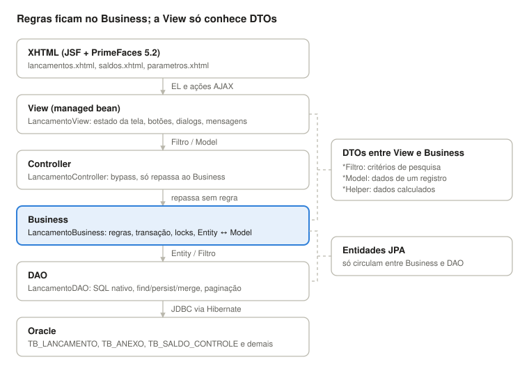
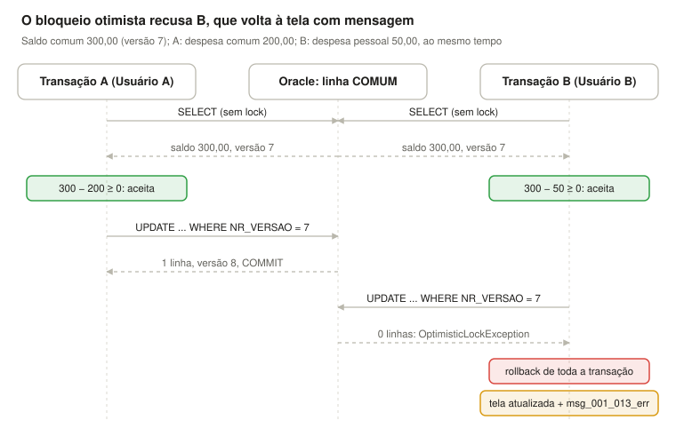
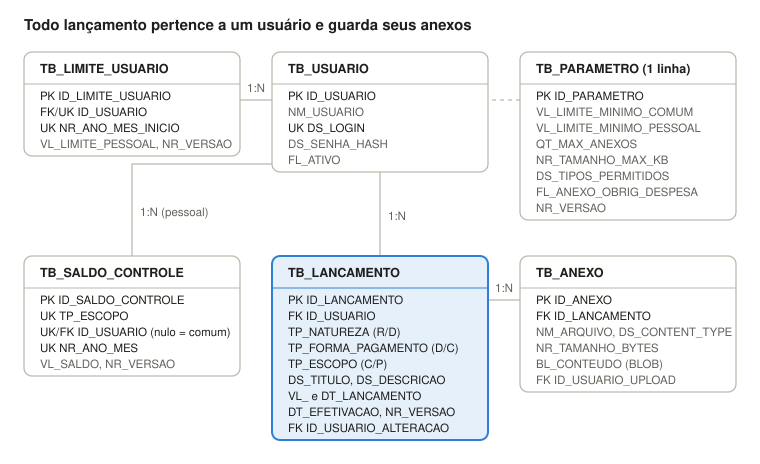

# Especificação técnica

Arquitetura, concorrência, modelo de dados e dicionário de dados (Oracle).

## 1. Arquitetura

Toda requisição desce por quatro camadas, e cada uma tem uma única responsabilidade. A View nunca acessa DAO diretamente, e regra de negócio nunca fica na View. As regras citadas como RNxx estão em [Telas e regras de negócio](02-telas-e-regras.md).



Disca: A chamada desce da tela ao banco; o retorno sobe como Model ou Helper, e entidades JPA nunca chegam à View.

| Camada | Classe (exemplo) | Responsabilidade | Não deve |
| --- | --- | --- | --- |
| XHTML | `lancamentos.xhtml` | Componentes PrimeFaces, bindings `#{lancamentoView...}` | Conter lógica além de `rendered`/`disabled` simples |
| View (managed bean) | `LancamentoView` (`@Named @ViewScoped`) | Estado da tela, habilitar/desabilitar botões, abrir dialogs, mensagens `FacesMessage`, chamar o Controller | Acessar `EntityManager` ou validar regra de negócio |
| Controller | `LancamentoController` | Bypass: repassa chamadas da View para o Business (mantém o padrão do sistema principal) | Ter regras |
| Business | `LancamentoBusiness` | Regras de negócio, validações, controle de transação e concorrência, conversão Entity ↔ Model | Montar componentes de tela |
| DAO | `LancamentoDAO` | Acesso ao Oracle via Hibernate: SQL nativo, `find`, `persist`, `merge` | Decidir regra de negócio |

### Convenção de DTOs

| Sufixo | Uso | Exemplos |
| --- | --- | --- |
| `*Filtro` | Critérios de pesquisa enviados da tela até o DAO (inclui paginação e ordenação) | `LancamentoFiltro` (usuário, natureza, escopo, forma, período, título, `first`, `pageSize`, `sortField`) |
| `*Model` ou `*Helper` | Dados de um registro trafegando entre camadas e exibidos na tela/dialog e/ou dados calculados ou agregados para exibição, sem entidade correspondente | `LancamentoModel`, `AnexoModel`, `ParametroModel`, `UsuarioModel`, `SaldoHelper` (saldo comum, saldo pessoal por usuário), `ResultadoPaginadoHelper<T>` (lista + total de registros) |

Entidades JPA (`Lancamento`, `Anexo`, `Usuario`, `Parametro`, `LimiteUsuario`, `SaldoControle`) ficam restritas ao Business e ao DAO; a View só conhece Models, Filtros e Helpers.

### Estrutura de pacotes sugerida

```
br.com.empresa.orcamento
 ├── view          (LancamentoView, SaldoView, ParametroView, LoginView, UsuarioLogadoView)
 ├── controller    (LancamentoController, SaldoController, ParametroController, LoginController)
 ├── business      (LancamentoBusiness, SaldoBusiness, ParametroBusiness, AnexoBusiness, LoginBusiness)
 ├── dao           (LancamentoDAO, AnexoDAO, ParametroDAO, UsuarioDAO, SaldoControleDAO)
 ├── entity        (Lancamento, Anexo, Usuario, Parametro, LimiteUsuario, SaldoControle)
 ├── dto
 │    ├── filtro   (LancamentoFiltro)
 │    ├── model    (LancamentoModel, AnexoModel, ParametroModel, UsuarioModel)
 │    └── helper   (SaldoHelper, ResultadoPaginadoHelper)
 ├── enums         (Natureza, FormaPagamento, Escopo)
 ├── filter        (AutenticacaoFilter)
 └── exception     (NegocioException, ConcorrenciaException)
```

## 2. Concorrência

Todo dinheiro sai do saldo comum, então toda receita e toda despesa (comum ou pessoal) alteram a linha comum de `TB_SALDO_CONTROLE`. Essa linha é protegida por **bloqueio otimista** do Hibernate: a coluna `NR_VERSAO` (`@Version`) muda a cada gravação, e quem tenta gravar com uma versão desatualizada é recusado. **Não há retentativa automática**: a operação inteira é desfeita, a tela mostra `msg_001_013_err` e é atualizada com os dados atuais, e o usuário decide se tenta de novo.

O mesmo vale para dois usuários editando o mesmo registro: `TB_LANCAMENTO`, `TB_PARAMETRO` e `TB_LIMITE_USUARIO` também têm `NR_VERSAO`, e quem salva por último recebe `msg_001_012_err` (lançamento) ou `msg_003_002_err` (parâmetros).



A e B leem a mesma versão; só o primeiro `UPDATE` encontra a linha na versão 7. O de B afeta 0 linhas, a transação de B é desfeita e a tela de B é atualizada com a mensagem.

### Pontos com tratamento de concorrência

Em todos os casos a operação é desfeita por inteiro, a mensagem é exibida e a tela (grid, dialog e saldos) é recarregada com os dados atuais.

| Ponto | Tratamento | Mensagem |
| --- | --- | --- |
| Incluir, editar ou excluir qualquer lançamento (altera o saldo comum) | `@Version` na linha comum de `TB_SALDO_CONTROLE` | `msg_001_013_err` |
| Incluir, editar ou excluir despesa pessoal | `@Version` na linha comum e na linha pessoal do mês; conflito em qualquer uma desfaz tudo | `msg_001_013_err` |
| Editar trocando mês de efetivação, escopo ou forma | Atualiza a linha pessoal do mês antigo e a do novo, além da comum, todas versionadas | `msg_001_013_err` |
| Primeira despesa pessoal do mês (criação da linha) | UK `(TP_ESCOPO, ID_USUARIO, NR_ANO_MES)`; a violação (ORA-00001) desfaz a operação | `msg_001_013_err` |
| Dois usuários editando o mesmo lançamento | `@Version` em `TB_LANCAMENTO` | `msg_001_012_err` |
| Editar ou excluir lançamento que o outro usuário excluiu (inclui excluir duas vezes) | O Business busca o registro pelo id antes de alterar; se não existe, recusa | `msg_001_021_err` |
| Anexar ou remover arquivo enquanto o outro edita o lançamento | Toda alteração de anexo incrementa a versão do lançamento (`LockModeType.OPTIMISTIC_FORCE_INCREMENT`) | `msg_001_012_err` |
| Dois usuários anexando ao mesmo lançamento além da quantidade máxima | O mesmo incremento de versão recusa o segundo; ao repetir, a contagem já inclui os anexos do primeiro | `msg_001_012_err`, depois `msg_001_016_err` |
| Baixar ou ver o preview de anexo já removido | O Business busca o anexo pelo id; se não existe, recusa | `msg_001_022_err` |
| Dois usuários salvando parâmetros | `@Version` em `TB_PARAMETRO` e `TB_LIMITE_USUARIO` | `msg_003_002_err` |
| Novo limite pessoal no mês corrente (criação do registro de vigência) | UK `(ID_USUARIO, NR_ANO_MES_INICIO)`; a violação desfaz a gravação | `msg_003_002_err` |
| Despesa lançada enquanto o outro altera o limite pessoal ou o limite mínimo | Parâmetro e limite lidos na mesma transação com `LockModeType.OPTIMISTIC` (versão conferida no commit) | `msg_001_023_err` |
| Regras de upload alteradas com a dialog aberta | Sem lock: o servidor revalida com as regras atuais ao gravar | `msg_001_014_err` a `msg_001_016_err` |
| Duplo clique em Salvar, Excluir ou anexar | Botão desabilitado e dialog bloqueada durante a requisição AJAX (`p:blockUI` ou `onstart`/`oncomplete`) | — |
| Mesmo usuário com duas abas abertas | Sem tratamento próprio: cai nos casos acima, como dois usuários | conforme o caso |
| Grid e tela de saldos mostrando dados antigos | Sem lock: o Business revalida toda ação; a tela é atualizada após qualquer mensagem de conflito | conforme o caso |

### Testes obrigatórios

- Duas threads (`ExecutorService` + `CountDownLatch`) lançando despesas ao mesmo tempo: exatamente uma gravada; a outra recebe o conflito de versão e nada dela fica gravado (nem o lançamento, nem os anexos).
- Depois do conflito, repetir a operação recusada: grava se o saldo atual comportar, ou é recusada por `msg_001_009_err` se não comportar.
- Uma despesa comum e uma pessoal simultâneas: o conflito aparece na linha comum.
- Duas primeiras despesas pessoais do mesmo usuário no mesmo mês, simultâneas: uma grava e cria a linha do mês; a outra recebe `msg_001_013_err`.
- Dois usuários editando o mesmo lançamento: o segundo recebe `msg_001_012_err`.
- Excluir um lançamento enquanto o outro o edita: quem chegar depois recebe `msg_001_021_err` ou `msg_001_012_err`.
- Dois usuários anexando ao mesmo lançamento ao mesmo tempo: o segundo recebe `msg_001_012_err`.
- Despesa pessoal lançada enquanto o limite pessoal é alterado: a despesa recebe `msg_001_023_err`.
- Logar cada conflito para o estagiário ver o bloqueio acontecendo.

## 3. Modelo de dados

São seis tabelas: o lançamento é o centro, com anexos, limites históricos por usuário e as linhas de saldo versionadas.



A linha tracejada é FK só de auditoria (quem alterou); TB_PARAMETRO não depende de usuário para funcionar.

## 4. Dicionário de dados (Oracle)

Schema `ORCAMENTO`. Toda PK é `NUMBER(19)` alimentada por sequence (`SQ_<tabela>`), mapeada com `@SequenceGenerator`. Valores monetários usam `NUMBER(15,2)` e `BigDecimal` no Java.

### TB_USUARIO — usuários do sistema (2 registros, criados por script)

| Coluna | Tipo | Nulo | Chave | Descrição |
| --- | --- | --- | --- | --- |
| ID_USUARIO | NUMBER(19) | Não | PK | Identificador (SQ_USUARIO) |
| NM_USUARIO | VARCHAR2(100) | Não |  | Nome exibido na tela |
| DS_LOGIN | VARCHAR2(50) | Não | UK | Login de acesso |
| DS_SENHA_HASH | VARCHAR2(255) | Não |  | Hash da senha (PBKDF2/BCrypt) |
| FL_ATIVO | CHAR(1) | Não |  | S/N, padrão S |
| DT_CRIACAO | TIMESTAMP | Não |  | Data de criação |

### TB_LANCAMENTO — receitas e despesas

| Coluna | Tipo | Nulo | Chave | Descrição |
| --- | --- | --- | --- | --- |
| ID_LANCAMENTO | NUMBER(19) | Não | PK | Identificador (SQ_LANCAMENTO) |
| ID_USUARIO | NUMBER(19) | Não | FK → TB_USUARIO | Dono do lançamento (quem lançou) |
| TP_NATUREZA | CHAR(1) | Não |  | R = Receita, D = Despesa (CHECK) |
| TP_FORMA_PAGAMENTO | CHAR(1) | Não |  | D = Débito, C = Crédito (CHECK) |
| TP_ESCOPO | CHAR(1) | Não |  | C = Comum (residência), P = Pessoal (CHECK) |
| DS_TITULO | VARCHAR2(100) | Não |  | Título curto |
| VL_LANCAMENTO | NUMBER(15,2) | Não |  | Valor, sempre > 0 (CHECK) |
| DS_DESCRICAO | VARCHAR2(500) | Sim |  | Descrição livre |
| DT_LANCAMENTO | DATE | Não |  | Data da compra/recebimento; usada na grid, nos filtros e na regra do ano corrente (RN05) |
| DT_EFETIVACAO | DATE | Não |  | Data em que o dinheiro sai ou entra: débito = DT_LANCAMENTO; crédito = vencimento da fatura. Define o mês dos saldos (RN14) |
| NR_VERSAO | NUMBER(10) | Não |  | Versão para bloqueio otimista (`@Version`) |
| DT_CRIACAO | TIMESTAMP | Não |  | Auditoria: inclusão |
| DT_ALTERACAO | TIMESTAMP | Sim |  | Auditoria: última alteração |
| ID_USUARIO_ALTERACAO | NUMBER(19) | Sim | FK → TB_USUARIO | Quem alterou por último |

Índices: `IX_LANC_DATA (DT_LANCAMENTO)`, `IX_LANC_USU_ESC_EFET (ID_USUARIO, TP_ESCOPO, DT_EFETIVACAO)`.

### TB_ANEXO — cupons e comprovantes

| Coluna | Tipo | Nulo | Chave | Descrição |
| --- | --- | --- | --- | --- |
| ID_ANEXO | NUMBER(19) | Não | PK | Identificador (SQ_ANEXO) |
| ID_LANCAMENTO | NUMBER(19) | Não | FK → TB_LANCAMENTO | Lançamento dono (ON DELETE CASCADE) |
| NM_ARQUIVO | VARCHAR2(255) | Não |  | Nome original do arquivo |
| DS_CONTENT_TYPE | VARCHAR2(100) | Não |  | MIME type (image/jpeg, image/png, application/pdf) |
| NR_TAMANHO_BYTES | NUMBER(12) | Não |  | Tamanho do arquivo |
| BL_CONTEUDO | BLOB | Não |  | Conteúdo binário (`@Lob @Basic(fetch = LAZY)`) |
| DT_UPLOAD | TIMESTAMP | Não |  | Data do upload |
| ID_USUARIO_UPLOAD | NUMBER(19) | Não | FK → TB_USUARIO | Quem anexou |

A grid nunca carrega `BL_CONTEUDO`; o conteúdo só é lido no download.

### TB_PARAMETRO — parametrização geral (registro único, ID = 1)

| Coluna | Tipo | Nulo | Chave | Descrição |
| --- | --- | --- | --- | --- |
| ID_PARAMETRO | NUMBER(19) | Não | PK | Sempre 1 |
| VL_LIMITE_MINIMO_COMUM | NUMBER(15,2) | Não |  | Menor saldo comum permitido após uma despesa (ex.: 0,00 ou −500,00) |
| VL_LIMITE_MINIMO_PESSOAL | NUMBER(15,2) | Não |  | Menor saldo pessoal disponível permitido após uma despesa |
| QT_MAX_ANEXOS | NUMBER(3) | Não |  | Máximo de anexos por lançamento (ex.: 3) |
| NR_TAMANHO_MAX_KB | NUMBER(8) | Não |  | Tamanho máximo por arquivo em KB (ex.: 2048) |
| DS_TIPOS_PERMITIDOS | VARCHAR2(100) | Não |  | Extensões separadas por vírgula (ex.: jpg,jpeg,png,pdf) |
| FL_ANEXO_OBRIG_DESPESA | CHAR(1) | Não |  | S/N: despesa exige ao menos um anexo |
| NR_VERSAO | NUMBER(10) | Não |  | Bloqueio otimista |
| DT_ALTERACAO | TIMESTAMP | Sim |  | Auditoria |
| ID_USUARIO_ALTERACAO | NUMBER(19) | Sim | FK → TB_USUARIO | Auditoria |

### TB_LIMITE_USUARIO — histórico do limite de crédito pessoal por usuário

| Coluna | Tipo | Nulo | Chave | Descrição |
| --- | --- | --- | --- | --- |
| ID_LIMITE_USUARIO | NUMBER(19) | Não | PK | Identificador (SQ_LIMITE_USUARIO) |
| ID_USUARIO | NUMBER(19) | Não | FK, UK (com NR_ANO_MES_INICIO) | Usuário |
| NR_ANO_MES_INICIO | NUMBER(6) | Não | UK (com ID_USUARIO) | AAAAMM a partir do qual o limite vale. Limite do mês M = registro com o maior NR_ANO_MES_INICIO ≤ M |
| VL_LIMITE_PESSOAL | NUMBER(15,2) | Não |  | Limite mensal, padrão 1000,00 |
| NR_VERSAO | NUMBER(10) | Não |  | Bloqueio otimista |
| DT_ALTERACAO | TIMESTAMP | Sim |  | Auditoria |

Ao salvar um novo limite: se já existe registro do usuário com `NR_ANO_MES_INICIO` = mês corrente, ele é atualizado; senão, um novo registro é inserido. Registros de meses anteriores nunca são alterados.

### TB_SALDO_CONTROLE — saldo consolidado e controle de versão

| Coluna | Tipo | Nulo | Chave | Descrição |
| --- | --- | --- | --- | --- |
| ID_SALDO_CONTROLE | NUMBER(19) | Não | PK | Identificador (SQ_SALDO_CONTROLE) |
| TP_ESCOPO | CHAR(1) | Não | UK | C = Comum, P = Pessoal |
| ID_USUARIO | NUMBER(19) | Sim | UK, FK → TB_USUARIO | Nulo para o comum |
| NR_ANO_MES | NUMBER(6) | Sim | UK | AAAAMM (mês de DT_EFETIVACAO); nulo para o comum (saldo acumulado) |
| VL_SALDO | NUMBER(15,2) | Não |  | Comum: saldo acumulado, atualizado por toda receita e despesa. Pessoal: valor consumido no mês |
| NR_VERSAO | NUMBER(10) | Não |  | Versão para bloqueio otimista (@Version); incrementada a cada UPDATE do saldo |
| DT_ATUALIZACAO | TIMESTAMP | Não |  | Última atualização |

UK: `(TP_ESCOPO, ID_USUARIO, NR_ANO_MES)`. A linha comum é criada no script inicial. As linhas pessoais são criadas na primeira despesa do mês; se duas transações tentarem criar a mesma linha, uma recebe violação de UK (ORA-00001), deve capturar, reler a linha e seguir.

### Enums Java

| Enum | Valores | Coluna |
| --- | --- | --- |
| `Natureza` | RECEITA("R"), DESPESA("D") | TP_NATUREZA |
| `FormaPagamento` | DEBITO("D"), CREDITO("C") | TP_FORMA_PAGAMENTO |
| `Escopo` | COMUM("C"), PESSOAL("P") | TP_ESCOPO |

Mapear com `AttributeConverter` (JPA 2.1) para gravar o código de 1 caractere.
