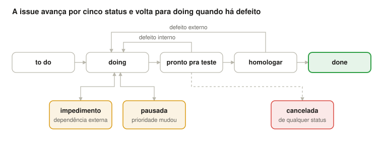

# Tarefas

Sete pacotes de entrega e 29 tarefas, uma por ação de tela; cada tarefa vira uma issue no GitHub copiando sua tabela.

## Como as tarefas estão organizadas

Cada **tela é um pacote de entrega** e cada **ação da tela é uma tarefa** (uma issue no GitHub), seguindo a ideia da análise de pontos de função (APF): cada entrada, consulta ou saída que o usuário dispara vira uma unidade pequena de trabalho. Sugestão: um *milestone* por pacote e uma issue por tarefa.

### Como ler cada tarefa

| Campo | O que significa |
| --- | --- |
| Título (cabeçalho) | Título da issue: `[P2] T2.1 Pesquisar lançamentos com filtro` |
| Labels | Tipo + área + status inicial (`to do`) |
| APF | Tipo da função: **EE** entrada externa (grava dados), **CE** consulta externa (recupera dados sem cálculo), **SE** saída externa (recupera com cálculo), **ALI** arquivo lógico interno (tabela/entidade) |
| Descrição | O que fazer, em poucas linhas |
| Entregável | O que deve existir ao final (classes, tela, script) |
| Aceite | Como o orientador confere que está pronto |
| Depende de | Tarefas que precisam estar prontas antes |

### Labels usadas

| Grupo | Labels | Uso |
| --- | --- | --- |
| Tipo | `desenvolvimento`, `atividade`, `teste`, `documentação` | Código de funcionalidade; tarefa sem código de produto (setup, estudo); escrita/execução de testes; documentação |
| Tipo (após entrega) | `melhoria`, `defeito interno`, `defeito externo` | Evolução; defeito achado pelo orientador antes da homologação; defeito achado na homologação/uso |
| Área | `front`, `back`, `banco`, `config`, `infra`, `seguranca` | Camada principal tocada (pode ter mais de uma) |
| Status | `to do`, `doing`, `pronto pra teste`, `homologar`, `done` | Fluxo normal da issue |
| Exceção | `impedimento`, `pausada`, `cancelada` | Travada por dependência; interrompida por prioridade; descartada |

O estagiário move a issue até `pronto pra teste`; daí em diante quem move é o orientador. Ao trocar o status, remover a label anterior.

### Visão geral dos pacotes

| Pacote | Tela | Tarefas | Funções APF |
| --- | --- | --- | --- |
| P0 — Fundação | — | T0.1 a T0.4 | ALI: Usuário, Lançamento/Anexo, Parâmetro/Limite, Saldo de controle |
| P1 — Login e logout | Login | T1.1 a T1.3 | EE: entrar, sair |
| P2 — Lançamentos | Grid de lançamentos | T2.1 a T2.4 | CE: pesquisar |
| P3 — Dialog de lançamento | Dialog | T3.1 a T3.7 | CE: consultar, baixar anexo · EE: incluir, alterar, excluir, anexar, remover anexo |
| P4 — Saldos e concorrência | Saldos | T4.1 a T4.6 | SE: consultar saldos |
| P5 — Parametrização | Parametrização | T5.1 a T5.2 | CE: consultar · EE: salvar |
| P6 — Fechamento | — | T6.1 a T6.3 | — |

Ordem sugerida: P0 → P1 → P2 → P3 → P5 → P4 → P6. A parametrização vem antes dos saldos porque os limites são lidos na validação.

## Pacote 0 — Fundação

Entrega: projeto rodando no WildFly, banco criado e entidades mapeadas, com uma página base com menu.

### [P0] T0.1 Configurar projeto e servidor

| Campo | Conteúdo |
| --- | --- |
| Labels | `atividade` `config` `infra` `to do` |
| APF | — |
| Descrição | Instalar JDK 8, Maven e WildFly 13. Criar projeto Maven `.war` com JSF, PrimeFaces 5.2, Hibernate e driver Oracle, na estrutura de pacotes da [Especificação técnica](03-especificacao-tecnica.md). Configurar datasource Oracle e `persistence.xml` (JTA). |
| Entregável | Projeto no repositório + README curto de como subir; página "Olá mundo" com um `p:panel` |
| Aceite | Orientador clona, sobe no WildFly seguindo o README e vê a página |
| Depende de | — |

### [P0] T0.2 Criar banco: DDL e carga inicial

| Campo | Conteúdo |
| --- | --- |
| Labels | `desenvolvimento` `banco` `to do` |
| APF | ALI (as 6 tabelas do dicionário de dados) |
| Descrição | Script DDL com tabelas, sequences, PK, FK, UK, CHECK e índices conforme o dicionário. Script de carga com 2 usuários (senha em hash), 2 limites de R$ 1.000,00 com vigência a partir de 202601, parâmetro ID 1 e linha de controle do saldo comum. |
| Entregável | `01_ddl.sql` e `02_carga.sql` em `src/main/resources/db` |
| Aceite | Scripts rodam do zero sem erro; CHECK rejeita valor ≤ 0 e natureza inválida |
| Depende de | — |

### [P0] T0.3 Mapear entidades JPA

| Campo | Conteúdo |
| --- | --- |
| Labels | `desenvolvimento` `back` `banco` `to do` |
| APF | ALI |
| Descrição | Entidades `Usuario`, `Lancamento`, `Anexo`, `Parametro`, `LimiteUsuario`, `SaldoControle` com `@SequenceGenerator`, `@Version`, `@Lob` lazy e enums com `AttributeConverter`. |
| Entregável | Pacotes `entity` e `enums` |
| Aceite | Deploy sem erro de mapeamento; um teste simples faz `find` de cada entidade da carga |
| Depende de | T0.1, T0.2 |

### [P0] T0.4 Template base com menu

| Campo | Conteúdo |
| --- | --- |
| Labels | `desenvolvimento` `front` `to do` |
| APF | — |
| Descrição | Template Facelets com `p:menubar` (Lançamentos, Saldos, Parametrização, Sair), área de conteúdo e `p:growl`/`p:messages` global. |
| Entregável | `template.xhtml` + páginas vazias das 3 telas usando o template |
| Aceite | Navegar pelo menu abre as 3 páginas com o mesmo layout |
| Depende de | T0.1 |

## Pacote 1 — Login e logout

Entrega: só usuário autenticado acessa as telas internas, e Sair encerra a sessão.

### [P1] T1.1 Entrar no sistema

| Campo | Conteúdo |
| --- | --- |
| Labels | `desenvolvimento` `front` `back` `seguranca` `to do` |
| APF | EE — entrar |
| Descrição | Tela de login (login + senha). `LoginView` → `LoginController` → `LoginBusiness` → `UsuarioDAO`. Validar hash da senha, guardar `UsuarioModel` no `UsuarioLogadoView` (`@SessionScoped`) e redirecionar para lançamentos. |
| Entregável | `login.xhtml`, `LoginView`, `LoginController`, `LoginBusiness`, `UsuarioDAO`, `UsuarioModel` |
| Aceite | Senha certa abre a grid; senha errada mostra mensagem genérica (sem dizer qual campo errou); senha não aparece em log |
| Depende de | T0.3, T0.4 |

### [P1] T1.2 Proteger páginas internas

| Campo | Conteúdo |
| --- | --- |
| Labels | `desenvolvimento` `back` `seguranca` `to do` |
| APF | — (parte do entrar) |
| Descrição | `WebFilter` que redireciona para o login quando não há usuário na sessão. Nome do usuário logado aparece no menu. |
| Entregável | `AutenticacaoFilter` |
| Aceite | Abrir `lancamentos.xhtml` direto pela URL, sem login, cai no login |
| Depende de | T1.1 |

### [P1] T1.3 Sair do sistema

| Campo | Conteúdo |
| --- | --- |
| Labels | `desenvolvimento` `front` `back` `to do` |
| APF | EE — sair |
| Descrição | Item Sair do menu invalida a sessão e redireciona para o login. |
| Entregável | Método `sair()` na `UsuarioLogadoView` |
| Aceite | Após Sair, voltar no navegador e tentar usar a tela leva ao login |
| Depende de | T1.2 |

## Pacote 2 — Tela de lançamentos

Entrega: grid paginada no banco, com filtros e botões que habilitam pela seleção.

### [P2] T2.1 Pesquisar lançamentos com filtro

| Campo | Conteúdo |
| --- | --- |
| Labels | `desenvolvimento` `front` `back` `banco` `to do` |
| APF | CE — pesquisar lançamentos |
| Descrição | Painel de filtros (período, natureza, escopo, forma, usuário, título contém) e botão Pesquisar. `LancamentoFiltro` desce até o DAO, que monta SQL nativo só com os critérios preenchidos, sempre com parâmetros nomeados. Período padrão = mês corrente. |
| Entregável | Painel de filtros no `lancamentos.xhtml`, `LancamentoFiltro`, `LancamentoModel`, `LancamentoDAO.pesquisar()` |
| Aceite | Cada filtro sozinho e combinado retorna o esperado; título com aspas simples não quebra a consulta (sem SQL injection) |
| Depende de | T1.1 |

### [P2] T2.2 Paginar e ordenar a grid no banco

| Campo | Conteúdo |
| --- | --- |
| Labels | `desenvolvimento` `front` `back` `banco` `to do` |
| APF | — (parte da pesquisa) |
| Descrição | `LazyDataModel` na `LancamentoView`. DAO com `COUNT(*)` e consulta com `OFFSET/FETCH` (ou `ROWNUM`) e `ORDER BY` pela coluna clicada (lista branca de colunas). `ResultadoPaginadoHelper` devolve lista + total. |
| Entregável | `LancamentoLazyModel`, `LancamentoDAO.contar()`, `ResultadoPaginadoHelper` |
| Aceite | Com 50+ registros, trocar de página busca só 10 linhas (conferir SQL no log); ordenar por Valor e Data funciona |
| Depende de | T2.1 |

### [P2] T2.3 Limpar filtros

| Campo | Conteúdo |
| --- | --- |
| Labels | `desenvolvimento` `front` `to do` |
| APF | — |
| Descrição | Botão Limpar volta os filtros ao padrão e repesquisa via AJAX, sem recarregar a página. |
| Entregável | Método `limpar()` na `LancamentoView` |
| Aceite | Após Limpar, filtros mostram o mês corrente e a grid volta à página 1 |
| Depende de | T2.1 |

### [P2] T2.4 Selecionar linha e habilitar botões

| Campo | Conteúdo |
| --- | --- |
| Labels | `desenvolvimento` `front` `back` `to do` |
| APF | — |
| Descrição | `selectionMode="single"` com `p:ajax` em `rowSelect`/`rowUnselect` atualizando o painel de botões (Novo, Consultar, Editar, Excluir). A View decide o estado; a regra de "pode editar" (ano corrente + dono, RN05/RN06) vem do Business. |
| Entregável | Painel de botões e propriedades `podeConsultar`/`podeEditar` na View |
| Aceite | Cenários CA03, CA04 e CA05 da Homologação final |
| Depende de | T2.2 |

## Pacote 3 — Dialog de lançamento

Entrega: CRUD completo de receitas e despesas com anexos, numa única dialog com três modos. A validação de saldo entra no pacote 4.

### [P3] T3.1 Consultar lançamento

| Campo | Conteúdo |
| --- | --- |
| Labels | `desenvolvimento` `front` `back` `to do` |
| APF | CE — consultar lançamento |
| Descrição | Botão Consultar abre a `p:dialog` em modo `CONSULTA`: campos desabilitados, lista de anexos e só o botão Fechar. Dados recarregados do banco pelo id (não usar a linha da grid). |
| Entregável | `dialogLancamento.xhtml` (include), enum `ModoDialog`, `LancamentoBusiness.consultar()` |
| Aceite | Dialog mostra todos os campos do registro selecionado sem permitir edição |
| Depende de | T2.4 |

### [P3] T3.2 Incluir receita ou despesa

| Campo | Conteúdo |
| --- | --- |
| Labels | `desenvolvimento` `front` `back` `banco` `to do` |
| APF | EE — incluir lançamento |
| Descrição | Botão Novo abre a dialog em modo `INCLUSAO`. Validar obrigatórios na tela (`required`) e RN01 a RN03 no Business; valor com `BigDecimal` e 2 casas. O campo Data de vencimento da fatura aparece só quando Forma = Crédito (`p:ajax` no change) e preenche `DT_EFETIVACAO`; no débito, `DT_EFETIVACAO` = Data. Salvar fecha a dialog e atualiza a grid via AJAX; erro mantém a dialog aberta com mensagem. |
| Entregável | `LancamentoBusiness.incluir()`, `LancamentoDAO.inserir()`, `NegocioException` |
| Aceite | Inclusão aparece na grid; valor 0 ou negativo é recusado; usuário gravado é sempre o logado; crédito sem data de fatura é recusado |
| Depende de | T3.1 |

### [P3] T3.3 Editar lançamento

| Campo | Conteúdo |
| --- | --- |
| Labels | `desenvolvimento` `front` `back` `to do` |
| APF | EE — alterar lançamento |
| Descrição | Botão Editar abre a dialog em modo `EDICAO`. Business revalida RN05 (ano corrente, data antiga e nova) e RN06 (pessoal só o dono). `NR_VERSAO` vai no Model e volta no salvar; conflito mostra "Registro alterado por outro usuário, recarregue". |
| Entregável | `LancamentoBusiness.alterar()` |
| Aceite | CA08 da Homologação final; editar lançamento do ano anterior forçando a chamada é recusado pelo Business |
| Depende de | T3.2 |

### [P3] T3.4 Excluir lançamento

| Campo | Conteúdo |
| --- | --- |
| Labels | `desenvolvimento` `front` `back` `to do` |
| APF | EE — excluir lançamento |
| Descrição | Botão Excluir abre `p:confirmDialog`. Mesmas regras do editar (RN05, RN06); anexos excluídos na mesma transação (RN18). |
| Entregável | `LancamentoBusiness.excluir()` |
| Aceite | Após confirmar, some da grid e os anexos somem do banco; cancelar não altera nada |
| Depende de | T3.3 |

### [P3] T3.5 Anexar arquivo

| Campo | Conteúdo |
| --- | --- |
| Labels | `desenvolvimento` `front` `back` `banco` `seguranca` `to do` |
| APF | EE — anexar arquivo |
| Descrição | `p:fileUpload` (modo avançado) na inclusão/edição, com `sizeLimit`, `fileLimit` e `allowTypes` lidos de `TB_PARAMETRO`. Revalidar no `AnexoBusiness` (tipo pelo conteúdo/MIME, não só pela extensão; tamanho; quantidade; RN16 anexo obrigatório em despesa). Gravar em `BL_CONTEUDO`. |
| Entregável | `AnexoBusiness`, `AnexoDAO`, `AnexoModel` |
| Aceite | CA09 da Homologação final; arquivo `.exe` renomeado para `.jpg` é recusado no servidor |
| Depende de | T3.2 |

### [P3] T3.6 Baixar anexo

| Campo | Conteúdo |
| --- | --- |
| Labels | `desenvolvimento` `front` `back` `to do` |
| APF | CE — baixar anexo |
| Descrição | Link Baixar em todos os modos, com `p:fileDownload` + `StreamedContent`. O BLOB só é lido nessa ação; a lista de anexos não carrega o conteúdo. |
| Entregável | `AnexoBusiness.baixar()` |
| Aceite | CA10 da Homologação final: arquivo baixado abre com o nome e o tipo originais |
| Depende de | T3.5 |

### [P3] T3.7 Remover anexo

| Campo | Conteúdo |
| --- | --- |
| Labels | `desenvolvimento` `front` `back` `to do` |
| APF | EE — remover anexo |
| Descrição | Botão Remover na lista de anexos, só em inclusão/edição. Respeita RN16 (despesa não pode ficar sem anexo se obrigatório). |
| Entregável | `AnexoBusiness.remover()` |
| Aceite | Anexo removido some da lista e do banco ao salvar; remover o único anexo de despesa obrigatória é recusado |
| Depende de | T3.5 |

## Pacote 4 — Saldos e concorrência

Entrega: todo lançamento atualiza o saldo comum (e o pessoal, quando for o caso) com bloqueio otimista, e a tela de saldos mostra a situação do mês. É o pacote central do projeto.

### [P4] T4.1 Atualizar e validar saldos ao gravar

| Campo | Conteúdo |
| --- | --- |
| Labels | `desenvolvimento` `back` `banco` `to do` |
| APF | — (regra interna das EE do pacote 3) |
| Descrição | `SaldoControleDAO` com `buscarComum()` e `buscarOuCriarPessoal()` (tratando violação de UK). Na inclusão, edição e exclusão: validar RN08 (comum) e RN11 (pessoal) e atualizar `VL_SALDO`, devolvendo o valor antigo antes na edição (RN12). O mês da linha pessoal vem de `DT_EFETIVACAO` (RN14) e o limite usado é o vigente naquele mês. |
| Entregável | `SaldoControle` usado pelo `LancamentoBusiness`; mensagens de saldo insuficiente com o valor disponível |
| Aceite | Exemplo de saldo pessoal ([Telas e regras de negócio](02-telas-e-regras.md)) reproduzido na tela; despesa pessoal também reduz o saldo comum |
| Depende de | T3.4 |

### [P4] T4.2 Bloqueio otimista no saldo

| Campo | Conteúdo |
| --- | --- |
| Labels | `desenvolvimento` `back` `front` `to do` |
| APF | — |
| Descrição | Mapear `NR_VERSAO` com `@Version` em `SaldoControle`. Ao receber `OptimisticLockException` (ou `StaleObjectStateException`), a transação inteira é desfeita, a View exibe `msg_001_013_err` e recarrega a grid e a dialog com os dados atuais. Sem retentativa automática. Logar cada conflito. Ver a seção Concorrência da [Especificação técnica](03-especificacao-tecnica.md). |
| Entregável | `ConcorrenciaException` e o tratamento do conflito no `LancamentoBusiness` e na `LancamentoView` |
| Aceite | Com depuração (breakpoint) em dois navegadores, o segundo salvar não grava nada, mostra `msg_001_013_err` e a tela passa a exibir o saldo atual |
| Depende de | T4.1 |

### [P4] T4.3 Testes de concorrência

| Campo | Conteúdo |
| --- | --- |
| Labels | `teste` `back` `to do` |
| APF | — |
| Descrição | Testes de integração com `ExecutorService` + `CountDownLatch` para os cenários de teste da seção Concorrência da [Especificação técnica](03-especificacao-tecnica.md). |
| Entregável | Classe `LancamentoConcorrenciaIT` |
| Aceite | Testes passam 10 execuções seguidas; saldo final e `NR_VERSAO` conferem com o esperado |
| Depende de | T4.2 |

### [P4] T4.4 Tela de saldos

| Campo | Conteúdo |
| --- | --- |
| Labels | `desenvolvimento` `front` `back` `banco` `to do` |
| APF | SE — consultar saldos |
| Descrição | Seletor de mês; saldo comum acumulado até o mês; para cada usuário: limite vigente no mês, consumido no mês, disponível e `p:progressBar`. Cálculo no `SaldoBusiness` com SQL nativo `SUM ... GROUP BY` por `DT_EFETIVACAO`, retornado em `SaldoHelper`. |
| Entregável | `saldos.xhtml`, `SaldoView`, `SaldoController`, `SaldoBusiness`, `SaldoHelper` |
| Aceite | Valores batem com a soma manual dos lançamentos do mês; trocar de mês atualiza via AJAX |
| Depende de | T4.1 |

### [P4] T4.5 Concorrência em lançamentos e anexos

| Campo | Conteúdo |
| --- | --- |
| Labels | `desenvolvimento` `back` `front` `to do` |
| APF | — |
| Descrição | Tratar os pontos de lançamento e anexo do quadro "Pontos com tratamento de concorrência" da [Especificação técnica](03-especificacao-tecnica.md): editar/excluir registro já excluído (`msg_001_021_err`); toda alteração de anexo incrementa a versão do lançamento com `OPTIMISTIC_FORCE_INCREMENT`; baixar ou ver preview de anexo removido (`msg_001_022_err`); desabilitar Salvar, Excluir e anexar durante a requisição AJAX (RN22). |
| Entregável | Ajustes em `LancamentoBusiness`, `AnexoBusiness`, `LancamentoView` e na dialog |
| Aceite | Cenários CA13, CA14 e CA16 da Homologação final |
| Depende de | T4.2 |

### [P4] T4.6 Concorrência em parâmetros, limites e criação de linhas

| Campo | Conteúdo |
| --- | --- |
| Labels | `desenvolvimento` `back` `banco` `to do` |
| APF | — |
| Descrição | Ler `TB_PARAMETRO` e o limite pessoal vigente com `LockModeType.OPTIMISTIC` na mesma transação da despesa (RN21, `msg_001_023_err`). Tratar violação de UK ao criar a linha pessoal do mês (`msg_001_013_err`) e o registro de vigência do limite (`msg_003_002_err`), sempre desfazendo a operação. |
| Entregável | Ajustes em `LancamentoBusiness`, `SaldoControleDAO` e `ParametroBusiness` |
| Aceite | Cenário CA15 da Homologação final; teste com duas primeiras despesas pessoais simultâneas no mês |
| Depende de | T4.2, T5.2 |

## Pacote 5 — Parametrização

Entrega: limites e regras de upload editáveis em tela, com proteção contra edição simultânea.

### [P5] T5.1 Consultar parâmetros

| Campo | Conteúdo |
| --- | --- |
| Labels | `desenvolvimento` `front` `back` `to do` |
| APF | CE — consultar parâmetros |
| Descrição | Tela abre em modo consulta com os limites pessoais vigentes dos 2 usuários, limites mínimos comum e pessoal e regras de anexo. Dados de `TB_PARAMETRO` + `TB_LIMITE_USUARIO` em um `ParametroModel`. |
| Entregável | `parametros.xhtml`, `ParametroView`, `ParametroController`, `ParametroBusiness`, `ParametroDAO`, `ParametroModel` |
| Aceite | Tela mostra os valores da carga inicial com campos desabilitados e só Editar ativo |
| Depende de | T1.1 |

### [P5] T5.2 Editar e salvar parâmetros

| Campo | Conteúdo |
| --- | --- |
| Labels | `desenvolvimento` `front` `back` `to do` |
| APF | EE — salvar parâmetros |
| Descrição | Editar habilita campos e Salvar/Cancelar. Validar: limite pessoal ≥ 0, tamanho máximo > 0, quantidade ≥ 1, ao menos um tipo de arquivo. Gravar com `@Version`; conflito mostra mensagem para recarregar. Limite pessoal: atualiza o registro do mês corrente ou insere um novo; meses anteriores ficam intactos. |
| Entregável | `ParametroBusiness.salvar()` |
| Aceite | CA11 da Homologação final; dois usuários salvando ao mesmo tempo: o segundo recebe a mensagem de conflito; novo limite de upload vale no próximo anexo; mudar o limite pessoal em outubro não altera o saldo de setembro |
| Depende de | T5.1 |

## Pacote 6 — Fechamento

Entrega: regras cobertas por testes, roteiro de homologação executado e projeto documentado.

### [P6] T6.1 Testes unitários do Business

| Campo | Conteúdo |
| --- | --- |
| Labels | `teste` `back` `to do` |
| APF | — |
| Descrição | JUnit + Mockito para as regras RN01 a RN18, com DAOs mockados. Um teste por regra, nomeado pelo código (ex.: `rn05_naoEditaLancamentoDeAnoAnterior`). |
| Entregável | Classes de teste em `src/test/java` |
| Aceite | `mvn test` verde; cada RN da [Telas e regras de negócio](02-telas-e-regras.md) tem ao menos um teste |
| Depende de | T4.2, T5.2 |

### [P6] T6.2 Homologação com dois usuários

| Campo | Conteúdo |
| --- | --- |
| Labels | `teste` `atividade` `to do` |
| APF | — |
| Descrição | Executar os cenários CA01 a CA16 da Homologação final com os dois usuários em navegadores diferentes, registrando resultado e evidência (print). Falhas viram issues com `defeito interno`. |
| Entregável | Planilha ou markdown com cenário, resultado e evidência |
| Aceite | Todos os cenários aprovados pelo orientador; issues passam para `homologar` → `done` |
| Depende de | T6.1 |

### [P6] T6.3 Documentar o projeto

| Campo | Conteúdo |
| --- | --- |
| Labels | `documentação` `to do` |
| APF | — |
| Descrição | README com como subir o ambiente, rodar scripts e testes, e decisões tomadas (ex.: por que bloqueio otimista e como o conflito é tratado). |
| Entregável | `README.md` atualizado |
| Aceite | Outra pessoa sobe o projeto do zero só lendo o README |
| Depende de | T6.2 |

## Homologação final e acompanhamento

O projeto está pronto quando os cenários abaixo passam com os dois usuários logados em navegadores diferentes.

| # | Cenário | Resultado esperado |
| --- | --- | --- |
| CA01 | Login com senha errada | Mensagem de erro, permanece no login |
| CA02 | Login correto | Abre a grid de lançamentos do mês corrente |
| CA03 | Nenhuma linha selecionada | Consultar, Editar e Excluir desabilitados |
| CA04 | Seleciona lançamento do ano anterior | Consultar habilitado; Editar e Excluir desabilitados |
| CA05 | Usuário B seleciona despesa pessoal do usuário A | Consultar habilitado; Editar e Excluir desabilitados |
| CA06 | Despesa pessoal acima do disponível no mês | Recusada com mensagem informando o saldo disponível |
| CA07 | Dois usuários lançam despesas (comuns ou pessoais) que, somadas, furam o limite mínimo comum | Uma gravada; a outra não grava nada, recebe msg_001_013_err e a tela é atualizada com o saldo atual |
| CA08 | Os dois editam o mesmo lançamento; o segundo salva depois | Segundo recebe "registro alterado por outro usuário" |
| CA09 | Upload de arquivo com tipo ou tamanho não permitido | Recusado na tela e, se forçado, no servidor |
| CA10 | Consulta de lançamento com anexo | Download do arquivo original, com nome e tipo corretos |
| CA11 | Altera limite pessoal para R$ 1.500,00 | Tela de saldos reflete o novo disponível no mês corrente; meses anteriores mantêm o limite antigo |
| CA12 | Grid com 50+ registros | Paginação no banco (verificar SQL no log), troca de página sem carregar tudo |
| CA13 | Usuário A exclui um lançamento comum que o usuário B está editando; B salva | B recebe msg_001_021_err e a grid é atualizada sem o registro |
| CA14 | Os dois anexam arquivos ao mesmo lançamento ao mesmo tempo; depois B tenta baixar um anexo que A removeu | O segundo a salvar recebe msg_001_012_err; o download recebe msg_001_022_err; as telas são atualizadas |
| CA15 | A altera o limite pessoal de B enquanto B salva uma despesa pessoal | A despesa de B recebe msg_001_023_err; ao repetir, é validada com o limite novo |
| CA16 | Duplo clique rápido em Salvar na inclusão | Só um lançamento é gravado; o botão fica desabilitado até a resposta |

### Rotina de acompanhamento

- Daily curta (15 min): o que fez, o que vai fazer, onde travou.
- Uma branch por tarefa (`feature/T2.1-pesquisar`) e pull request revisado pelo orientador.
- Revisão de fim de pacote com checklist: camadas respeitadas, DTOs com o sufixo certo, nenhuma regra na View, SQL com parâmetros, transação e concorrência no Business.
