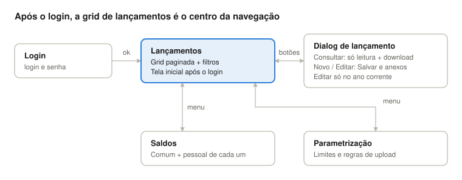
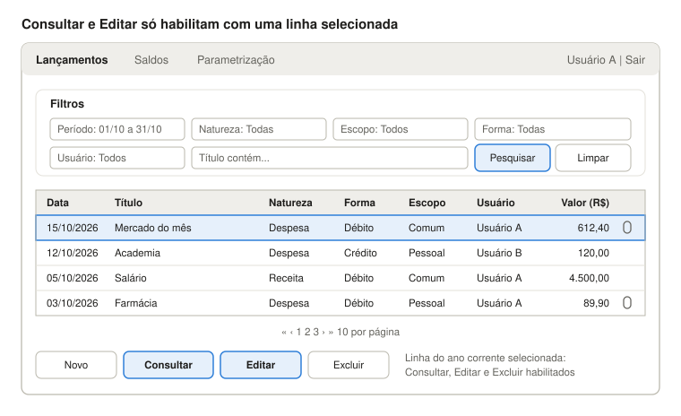
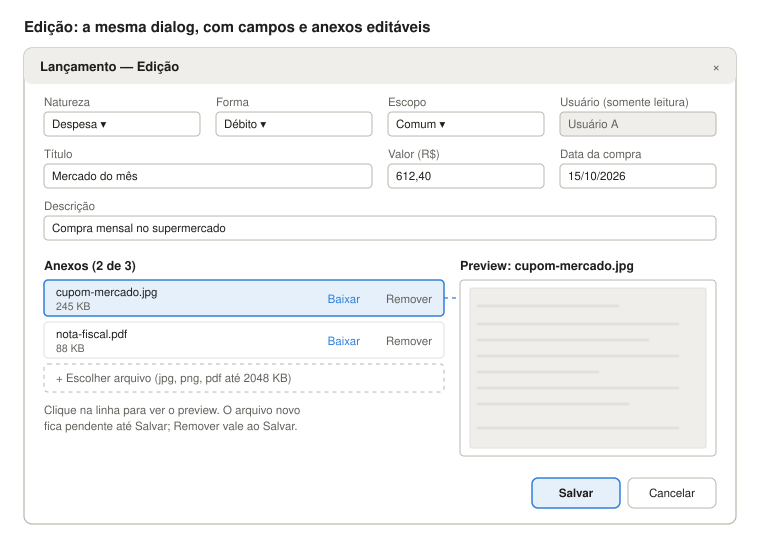
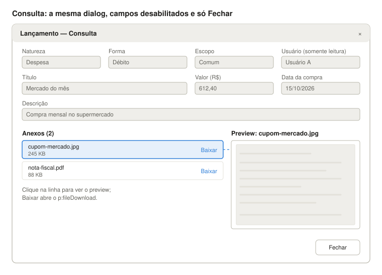
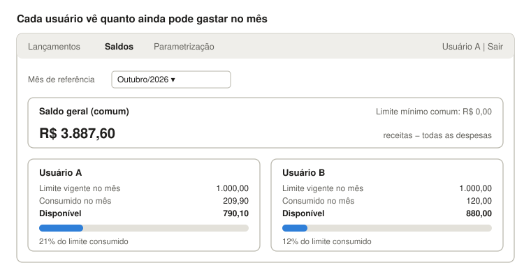
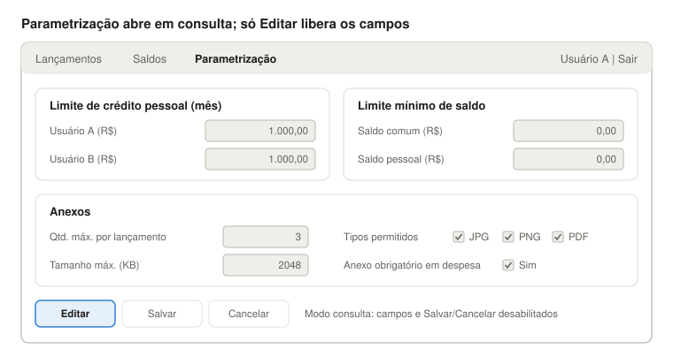

# Protótipos de tela

Só os prints das telas, para consulta rápida durante o desenvolvimento. O comportamento de cada tela, as regras e as mensagens estão em [Telas e regras de negócio](02-telas-e-regras.md). Os valores são ilustrativos.

## 1. Navegação entre telas

## 2. Lançamentos (tela inicial)

## 3. Dialog de lançamento

Uma só `p:dialog` para consulta, inclusão e edição, sempre com o mesmo layout: campos em cima e anexos em duas colunas (lista à esquerda, preview à direita). Só o modo muda o que fica habilitado.

### 3.1 Modo inclusão / edição

### 3.2 Modo consulta

| Modo | Campos | Anexos | Botões |
| --- | --- | --- | --- |
| Inclusão | Vazios e habilitados | Upload, Remover, Baixar, preview | Salvar, Cancelar |
| Edição | Preenchidos e habilitados (só ano corrente) | Upload, Remover, Baixar, preview | Salvar, Cancelar |
| Consulta | Preenchidos e desabilitados | Baixar, preview | Fechar |

## 4. Saldos

## 5. Parametrização

Ao clicar em Editar, os campos e os botões Salvar/Cancelar habilitam e o Editar desabilita.